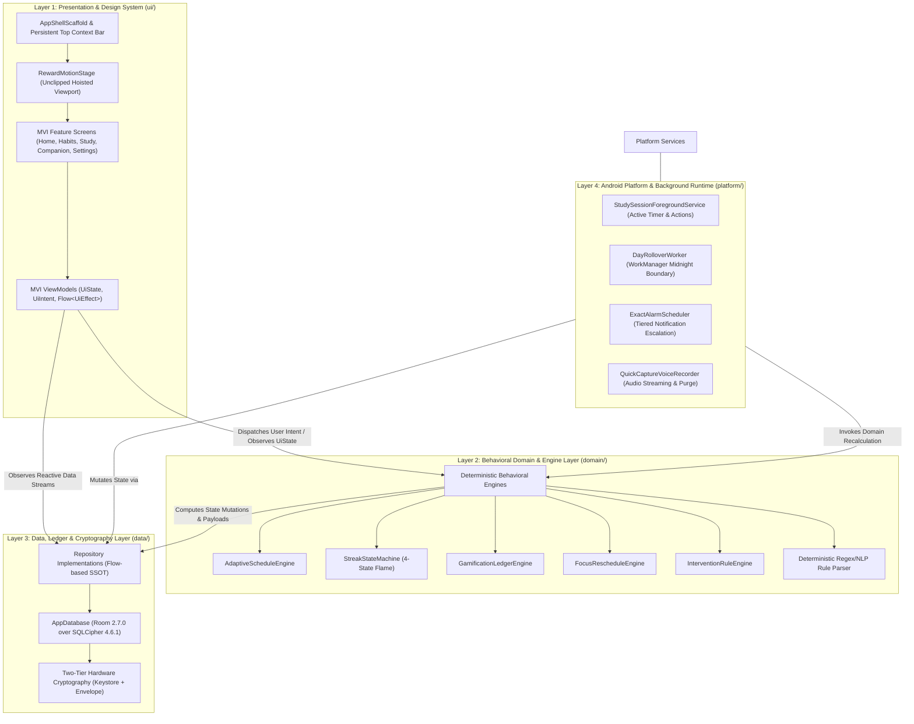
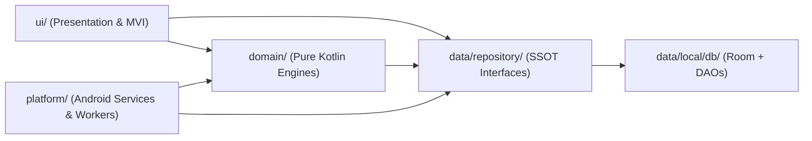
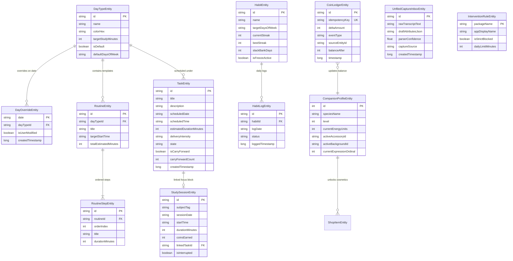

# Architecture Spine — Personal-Tracker

## Design Paradigm

Personal-Tracker v1 is architected on a **4-Layer MVI (Model-View-Intent) + Behavioral Engine** pattern with a strict Unidirectional Data Flow (UDF). The design establishes total decoupling between transient Android presentation components, pure Kotlin deterministic business logic, local-first encrypted persistence, and OS-bound background execution services.



### Layer Responsibilities
1. **Layer 1: Presentation & Design System (`ui/`):**
   - **`AppShellScaffold`:** Global application container hosting the persistent Top Context Bar (`DayTypeChip`, `StreakFlameBadge`, and live `CoinPill` target coordinates) and bottom 5-tab navigation.
   - **`RewardMotionStage`:** Hoisted above navigation hosts to render full-viewport vector/particle animations (`CoinArcAnimation`, milestone celebrations) without layout clipping.
   - **`QuickCaptureSheet`:** Ubiquitous floating capture drawer with live waveform amplitude visualizer and dual voice/text inputs.
   - **MVI Screen Components:** Stateless Jetpack Compose functions bound 1:1 to ViewModels emitting immutable `StateFlow<UiState>`, handling user input via `UiIntent`, and consuming one-shot transient events via `Flow<UiEffect>`.

2. **Layer 2: Behavioral Domain & Engine Layer (`domain/`):**
   - 100% pure Kotlin logic with zero Android framework dependencies.
   - Houses deterministic state machines and calculation engines:
     - **`AdaptiveScheduleEngine`:** Dynamically scales routine durations, step schedules, and study targets when switching `DayTypeEntity` templates.
     - **`StreakStateMachine`:** Computes non-punitive 4-state flame transitions (`COLD` -> `WARMING` -> `BURNING` -> `BLAZING`) enforcing miss-tolerant slack banking and freeze grace.
     - **`GamificationLedgerEngine`:** Calculates coin rewards, generates deterministic idempotency keys, updates companion energy, and produces reward animation payloads.
     - **`FocusRescheduleEngine`:** Evaluates pauses and interruptions during focus sessions, recalibrating remaining study blocks without guilt copy.
     - **`InterventionRuleEngine`:** Evaluates real-time app distraction rules and cooldowns to generate Just-In-Time Adaptive Intervention (JITAI) nudges.
     - **`ResolveDayTypeUseCase`:** Evaluates morning schedule resolution hierarchy: Date-Specific User Override > Day-of-Week Default.

3. **Layer 3: Data, Ledger & Cryptography Layer (`data/`):**
   - **Repository Layer:** Single Source of Truth (SSOT) exposing coroutine `Flow` streams for UI observation.
   - **Encrypted Room Database:** Encrypted at rest via SQLCipher 4.6.1 with PBKDF2-HMAC-SHA512 (256,000 iterations) and 4096-byte page size.
   - **Two-Tier Hardware Security:**
     - Master Database Key: 256-bit AES-GCM key in hardware-backed Android Keystore (`PersonalTracker_MasterDB_Key`).
     - Vault Key Storage: 32-byte `SecureRandom` passphrase encrypted in app-private storage (`pt_db_vault.bin`).
     - Envelope Field Encryption: Transparent `TypeConverter` protecting sensitive text fields in memory and storage via `EncryptedPayload`.
   - **Append-Only Ledger:** `CoinLedgerEntity` audit log enforcing unique compound idempotency keys.

4. **Layer 4: Android Platform & Background Runtime (`platform/`):**
   - **`StudySessionForegroundService`:** Manages high-precision focus and break countdown timers across lock-screen states with notification action intents.
   - **`DayRolloverWorker`:** WorkManager periodic job executed at the user's custom midnight boundary to evaluate daily routine rollover and habit streaks.
   - **`ExactAlarmScheduler`:** Schedules tiered notifications via `setAlarmClock()` without battery-draining polling.
   - **`QuickCaptureVoiceRecorder`:** Captures microphone input, streams live amplitude to the UI waveform visualizer, routes audio to speech engines, and immediately purges raw audio buffers.

---

## Invariants & Rules

### AD-1 — Strict 4-Layer Dependency Direction & UI Isolation

- **Binds:** `ui`, `domain`, `data`, `platform`, all compilation modules
- **Prevents:** Presentation components directly querying database DAOs or system services; domain logic coupling to Android UI lifecycles; circular module dependencies.
- **Rule:** Dependencies flow strictly downward: `ui` -> `domain` -> `data` / `platform`. Presentation components must consume business logic exclusively through Domain UseCases/Engines and Repositories. The `domain` layer must remain 100% pure Kotlin (`kotlin.*`, `kotlinx.coroutines.*`, `java.time.*`) with zero Android framework imports (`android.*`). Data Access Objects (DAOs) and Entities are strictly `internal` to the data layer.



### AD-2 — Unidirectional Reactive MVI Contract

- **Binds:** `ui/screens/*`, `ui/components/*`, all ViewModels
- **Prevents:** Fragmented mutable states across UI layers, concurrent state races, lost one-shot UI side-effects (navigation, haptics, coin animations).
- **Rule:** Every screen surface must be defined by three immutable contracts:
  1. `UiState`: A single, immutable data class representing the complete screen state.
  2. `UiIntent`: A sealed interface representing all explicit user interactions or lifecycle triggers.
  3. `UiEffect`: A sealed interface representing one-shot transient events (e.g., triggering coin arcs, snackbars, or navigation).
  ViewModels must expose `StateFlow<UiState>` for persistent rendering and a Channel-backed `Flow<UiEffect>` for side effects. Composables emit intents through lambda parameters and must never contain business or mutation logic.

### AD-3 — Pure Kotlin Behavioral Engines with Zero UI Coupling

- **Binds:** `domain/engine/*`, `domain/usecase/*`, `domain/model/*`
- **Prevents:** Business calculations and gamification rules leaking into Android UI components; untestable lifecycle-dependent logic; desynchronized calculations between foreground UI and background workers.
- **Rule:** All system behavioral logic (`AdaptiveScheduleEngine`, `StreakStateMachine`, `GamificationLedgerEngine`, `FocusRescheduleEngine`, `InterventionRuleEngine`) must be implemented as stateless or repository-driven pure Kotlin classes. All calculations take domain models as input and return new domain models or transactional calculation payloads. Unit testing for engines must execute completely on the standard JVM without Robolectric or Android emulator overhead.

### AD-4 — Non-Punitive Behavioral State & Atomic Idempotent Ledgering

- **Binds:** `StreakStateMachine`, `GamificationLedgerEngine`, `CoinLedgerEntity`, `CoinLedgerDao`, `CompanionProfileEntity`
- **Prevents:** Demoralizing streak resets, weaponized guilt mechanics, client-side coin duplication via rapid tap farming, corrupted balances.
- **Rule:** Missed days never drop streaks directly to zero if slack bank or freeze days are available. The companion pet state machine has zero health points (HP), hunger decay, or death mechanics. Every coin earning or deduction must be committed to `CoinLedgerEntity` with a deterministic, unique `idempotencyKey` (e.g. `TASK_COMP_<id>`, `ROUTINE_COMP_<id>_<date>`). Duplicate transactions must fail or be ignored atomically via Room `@Insert(onConflict = OnConflictStrategy.ABORT)` within a `@Transaction`. Coin balances are derived exclusively from the verified ledger.

### AD-5 — Two-Tier Hardware Cryptography & Local-First Isolation

- **Binds:** `data/local/security/*`, `data/local/db/*`, `AppDatabase`, `EncryptedPayload`
- **Prevents:** Plaintext data leaks, cold storage extraction, accidental cloud telemetry or third-party credential exposure.
- **Rule:** Data protection operates on two distinct hardware-isolated tiers:
  - **Tier 1 (Database at Rest):** The complete SQLite database file is encrypted at rest using SQLCipher 4.6.1 with PBKDF2-HMAC-SHA512 (256,000 iterations) and a 4096-byte page size. The 32-byte encryption key is generated via `SecureRandom` and persisted inside `pt_db_vault.bin`, encrypted by an Android Keystore master key (`PersonalTracker_MasterDB_Key`, AES-256-GCM, `setUserAuthenticationRequired(false)`).
  - **Tier 2 (Envelope Field Encryption):** High-sensitivity fields (voice capture transcripts, free-form notes) are encrypted via `EncryptedPayload` (12-byte random IV + 128-bit authentication tag) via Room TypeConverters. Zero analytics SDKs, zero remote trackers, and zero cloud network calls are permitted for core personal productivity features.

### AD-6 — Atomic Cross-Domain Behavioral Transactions

- **Binds:** `data/local/db/*`, all DAOs, `AppDatabase`
- **Prevents:** Inconsistent database state where task completion commits but coin rewards, routine progress, or companion energy fails.
- **Rule:** Any operation mutating multiple entities across domain boundaries (such as completing a routine step, updating streak records, awarding coins, and updating companion experience) must execute inside a Room `@Transaction`. All database access must be dispatched on `Dispatchers.IO` through repository facades.

### AD-7 — Strict Design-Token Consumption & Viewport-Hoisted Motion

- **Binds:** `ui/theme/*`, `ui/components/*`, `AppShellScaffold`, `RewardMotionStage`
- **Prevents:** Hardcoded dimensions, inconsistent typography, broken dark/light theme contrast, animation clipping across nested scroll containers.
- **Rule:** All Jetpack Compose UI elements must strictly resolve dimensions, colors, typography, shapes, and elevations from `com.personaltracker.ui.theme` tokens (`ColorTokens`, `TypographyTokens`, `SpacingTokens`, `ShapeTokens`, `ElevationTokens`, `AnimationTokens`). Direct hex colors, hardcoded `dp`, or raw `sp` values in composables are prohibited. Particle and reward animations must be hoisted to `RewardMotionStage` at the root scaffold level to prevent layout bounds clipping. All interactive touch targets must meet the 48dp minimum floor.

### AD-8 — Dual-Engine Voice Capture & AI Action Boundary

- **Binds:** `platform/voice/*`, `domain/parser/*`, `UnfiledCaptureInboxEntity`
- **Prevents:** Assistant unavailability during network loss, microphone audio leaks, irreversible autonomous system mutations.
- **Rule:** Voice capture operates over a dual-engine architecture:
  - **Online Path:** Gemini Live API over WebSocket for conversational parsing and context.
  - **Offline Path:** On-device Android `SpeechRecognizer` + deterministic Kotlin regex NLP rule parser.
  - **Fallback Path:** Immediate manual text quick-add bar.
  Audio buffers must be purged from memory immediately post-transcription. 3-tier confidence routing governs action commitment:
  - High Confidence (>0.85): Instant commit with a 5-second reversible undo toast.
  - Medium Confidence (0.50–0.85): 1-tap confirmation chips presented in `QuickCaptureSheet`.
  - Low Confidence (<0.50): Saved to `UnfiledCaptureInboxEntity` for manual triage. No autonomous destructive action may occur without explicit user confirmation or reversible grace window.

---

## Consistency Conventions

| Concern | Convention |
| --- | --- |
| **MVI Component Naming** | `{Feature}Screen.kt`, `{Feature}ViewModel.kt`, `{Feature}UiState.kt`, `{Feature}UiIntent.kt`, `{Feature}UiEffect.kt` |
| **Domain Engine Naming** | `{Concept}Engine.kt` for calculations; `{Verb}{Concept}UseCase.kt` for single actions |
| **Room Data Layer Naming** | `{Concept}Entity.kt` for tables; `{Concept}Dao.kt` for access interfaces; `{Concept}Repository.kt` for SSOT |
| **Identifiers & Keys** | Primary keys use UUIDv4 string representations; compound idempotency keys use `{DOMAIN}_{ACTION}_{ID}` format |
| **Date & Time Formats** | Dates stored as ISO-8601 calendar strings (`YYYY-MM-DD`); times stored as 24-hour strings (`HH:mm`); timestamps stored as UTC Unix epoch milliseconds (`Long`) |
| **Financial & Reward Math** | Coins, streaks, and experience are strictly non-negative integers (`Int`); floating-point values are prohibited for currency or score tracking |
| **Threading & Coroutines** | `Dispatchers.Main` for UI state collection; `Dispatchers.Default` for behavioral engines and parsers; `Dispatchers.IO` for Room database and Keystore operations |

---

## Stack

| Name | Version |
| --- | --- |
| Kotlin | 2.1.0 |
| JDK | 21 |
| Android Gradle Plugin (AGP) | 8.10.1 |
| Kotlin Symbol Processing (KSP) | 2.1.0-1.0.29 |
| Jetpack Compose BOM | 2026.02.00 |
| AndroidX Activity Compose | 1.10.0 |
| AndroidX Navigation Compose | 2.8.7 |
| AndroidX Lifecycle & ViewModel | 2.8.7 |
| Dagger Hilt | 2.58 |
| Hilt Navigation Compose | 1.2.0 |
| Room Runtime & Compiler | 2.7.0 |
| SQLCipher Android | 4.6.1 |
| AndroidX DataStore Preferences | 1.1.2 |
| AndroidX WorkManager | 2.10.0 |
| Kotlinx Coroutines | 1.10.1 |
| Kotlinx Serialization JSON | 1.8.0 |
| Rive Android Runtime | 9.1.0 |
| Airbnb Lottie Compose | 6.6.2 |
| JUnit | 4.13.2 |
| CashApp Turbine | 1.2.0 |
| AndroidX Test Ext JUnit | 1.2.1 |
| AndroidX Espresso Core | 3.6.1 |

---

## Structural Seed

### 1. Detailed Package Tree (`com.personaltracker`)

```text
com.personaltracker/
├── PersonalTrackerApplication.kt
├── MainActivity.kt
├── di/
│   ├── DatabaseModule.kt
│   ├── RepositoryModule.kt
│   ├── DomainEngineModule.kt
│   └── PlatformModule.kt
├── domain/
│   ├── model/
│   │   ├── DayType.kt
│   │   ├── Task.kt
│   │   ├── Routine.kt
│   │   ├── Habit.kt
│   │   ├── StudySession.kt
│   │   ├── CompanionProfile.kt
│   │   └── CoinTransaction.kt
│   ├── engine/
│   │   ├── AdaptiveScheduleEngine.kt
│   │   ├── StreakStateMachine.kt
│   │   ├── GamificationLedgerEngine.kt
│   │   ├── FocusRescheduleEngine.kt
│   │   └── InterventionRuleEngine.kt
│   ├── parser/
│   │   ├── NaturalLanguageCommandParser.kt
│   │   └── ConfidenceScorer.kt
│   └── usecase/
│       ├── ResolveDayTypeUseCase.kt
│       ├── CompleteTaskUseCase.kt
│       ├── LogHabitUseCase.kt
│       └── CaptureQuickThoughtUseCase.kt
├── data/
│   ├── repository/
│   │   ├── DayTypeRepositoryImpl.kt
│   │   ├── TaskRepositoryImpl.kt
│   │   ├── RoutineRepositoryImpl.kt
│   │   ├── HabitRepositoryImpl.kt
│   │   ├── StudySessionRepositoryImpl.kt
│   │   ├── EconomyRepositoryImpl.kt
│   │   └── UnfiledInboxRepositoryImpl.kt
│   └── local/
│       ├── db/
│       │   ├── AppDatabase.kt
│       │   ├── converters/
│       │   │   ├── DateConverters.kt
│       │   │   └── EncryptedPayloadConverter.kt
│       │   ├── daos/
│       │   │   ├── DayTypeDao.kt
│       │   │   ├── TaskDao.kt
│       │   │   ├── RoutineDao.kt
│       │   │   ├── HabitDao.kt
│       │   │   ├── StudySessionDao.kt
│       │   │   ├── CoinLedgerDao.kt
│       │   │   ├── CompanionProfileDao.kt
│       │   │   ├── UnfiledInboxDao.kt
│       │   │   └── InterventionRuleDao.kt
│       │   └── entities/
│       │       ├── DayTypeEntity.kt
│       │       ├── DayOverrideEntity.kt
│       │       ├── TaskEntity.kt
│       │       ├── RoutineEntity.kt
│       │       ├── RoutineStepEntity.kt
│       │       ├── HabitEntity.kt
│       │       ├── HabitLogEntity.kt
│       │       ├── StudySessionEntity.kt
│       │       ├── CoinLedgerEntity.kt
│       │       ├── CompanionProfileEntity.kt
│       │       ├── ShopItemEntity.kt
│       │       ├── UnfiledCaptureInboxEntity.kt
│       │       └── InterventionRuleEntity.kt
│       └── security/
│           ├── SecurityKeyStoreManager.kt
│           ├── DatabaseKeyProvider.kt
│           └── EncryptedPayload.kt
├── platform/
│   ├── timer/
│   │   └── StudySessionForegroundService.kt
│   ├── worker/
│   │   └── DayRolloverWorker.kt
│   ├── alarm/
│   │   └── ExactAlarmScheduler.kt
│   └── voice/
│       ├── QuickCaptureVoiceRecorder.kt
│       ├── AndroidSpeechRecognizerClient.kt
│       └── GeminiLiveWebSocketClient.kt
└── ui/
    ├── theme/
    │   ├── Color.kt
    │   ├── Type.kt
    │   ├── Shape.kt
    │   ├── Spacing.kt
    │   ├── Elevation.kt
    │   ├── AnimationTokens.kt
    │   └── Theme.kt
    ├── navigation/
    │   ├── PersonalTrackerDestination.kt
    │   ├── PersonalTrackerNavHost.kt
    │   └── NavigationBar.kt
    ├── components/
    │   ├── atoms/
    │   ├── cards/
    │   │   ├── HeroCard.kt
    │   │   ├── TaskCard.kt
    │   │   ├── RoutineCard.kt
    │   │   └── HabitCard.kt
    │   ├── overlays/
    │   │   ├── AppShellScaffold.kt
    │   │   ├── QuickCaptureSheet.kt
    │   │   └── RewardMotionStage.kt
    │   ├── animation/
    │   │   ├── CoinArcAnimation.kt
    │   │   └── WaveformVisualizer.kt
    │   └── companion/
    │       └── CompanionView.kt
    └── screens/
        ├── home/
        │   ├── HomeScreen.kt
        │   ├── HomeViewModel.kt
        │   ├── HomeUiState.kt
        │   ├── HomeUiIntent.kt
        │   └── HomeUiEffect.kt
        ├── habits/
        │   ├── HabitsScreen.kt
        │   ├── HabitsViewModel.kt
        │   ├── HabitsUiState.kt
        │   ├── HabitsUiIntent.kt
        │   └── HabitsUiEffect.kt
        ├── study/
        │   ├── StudyScreen.kt
        │   ├── StudyViewModel.kt
        │   ├── StudyUiState.kt
        │   ├── StudyUiIntent.kt
        │   └── StudyUiEffect.kt
        ├── companion/
        │   ├── CompanionScreen.kt
        │   ├── CompanionViewModel.kt
        │   ├── CompanionUiState.kt
        │   ├── CompanionUiIntent.kt
        │   └── CompanionUiEffect.kt
        └── settings/
            ├── SettingsScreen.kt
            ├── SettingsViewModel.kt
            ├── SettingsUiState.kt
            ├── SettingsUiIntent.kt
            └── SettingsUiEffect.kt
```

### 2. Core Entity-Relationship Diagram



---

## Capability → Architecture Map

| Capability / Area | Lives in | Governed by |
| --- | --- | --- |
| **FR-1: Dynamic Hero Card & Home Surface** | `ui/screens/home/`, `ui/components/cards/HeroCard.kt` | AD-1, AD-2, AD-7 |
| **FR-2: Domain Task & Routine Models** | `domain/model/`, `data/local/db/entities/` | AD-1, AD-3, AD-6 |
| **FR-3: DayType Resolution & Morning Swap** | `domain/engine/AdaptiveScheduleEngine.kt`, `domain/usecase/ResolveDayTypeUseCase.kt` | AD-1, AD-3 |
| **FR-4: Focus Mode & Intervention Engine** | `domain/engine/FocusRescheduleEngine.kt`, `platform/timer/StudySessionForegroundService.kt` | AD-1, AD-3 |
| **FR-5: Tiered Notifications & Exact Alarms** | `platform/alarm/ExactAlarmScheduler.kt` | AD-1, AD-8 |
| **FR-6: Evening Carry-Forward Review** | `ui/screens/home/`, `domain/usecase/` | AD-2, AD-3 |
| **FR-7: Dual Voice Engine & Confidence Routing** | `platform/voice/`, `domain/parser/NaturalLanguageCommandParser.kt` | AD-8 |
| **FR-8: Non-Punitive Companion & Coins Ledger** | `domain/engine/GamificationLedgerEngine.kt`, `data/local/db/daos/CoinLedgerDao.kt` | AD-3, AD-4, AD-5 |
| **FR-9: Two-Tier Cryptography & Encrypted Backup** | `data/local/security/`, `data/local/db/AppDatabase.kt` | AD-5 |
| **FR-10: Distraction App Blocking & JITAI** | `domain/engine/InterventionRuleEngine.kt`, `platform/` | AD-1, AD-3 |

---

## Deferred

| Item | Scope Altitude | Revisit Condition |
| --- | --- | --- |
| **Multi-Device Encrypted Cloud Sync** | Initiative / v2 Scope | Out of v1 scope; v1 relies exclusively on local hardware storage and exportable `.ptbackup` encrypted archives. |
| **Tablet & Foldable Adaptive Multi-Pane UI** | Feature / UI Scope | v1 focuses strictly on Android phone viewports (portrait 360–430dp width). Responsive multi-column layout is deferred until core workflows complete. |
| **Custom Enterprise Gemini Proxy Endpoints** | Infrastructure Scope | v1 targets native Google Gemini Live API integration directly from the client without intermediary custom server proxies. |
| **Wear OS Companion Watch Tile** | Ecosystem Extension | v1 targets native Android phone runtime (API 33–36). Wearable companion synchronization deferred to post-v1 milestone. |
