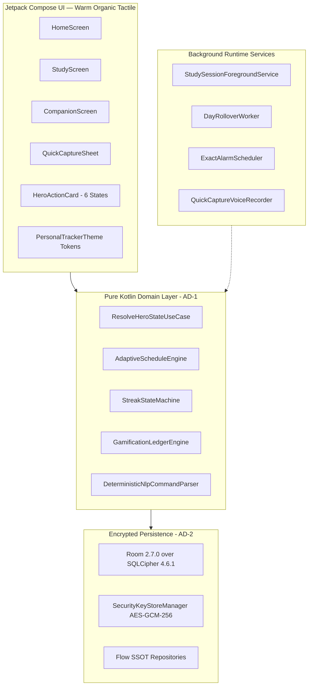

# HANDOFF.md — Personal-Tracker

## 1. Snapshot
*   **Project Name:** Personal-Tracker
*   **One-line Purpose:** Local-first, network-optional native Android personal productivity companion with SQLCipher encrypted persistence, pure Kotlin behavioral engines, voice quick-capture, and a non-punishing companion pet.
*   **Date/Time:** 2026-10-26 08:44:00 +05:30
*   **Current Git Commit:** Tracking Story 2.3 implementation
*   **Tech Stack & Versions:**
    *   **Language & Runtime:** Kotlin 2.1.0, JDK 21 (Eclipse Temurin 21.0.6 / JBR 21.0.11), Gradle 9.4+ / AGP 8.8.0
    *   **UI Toolkit:** Jetpack Compose BOM 2026.02.00, Material 3 (1.3.1), Warm Organic Tactile Design Language
    *   **Dependency Injection:** Hilt 2.58 (`ksp` only; zero KAPT)
    *   **Persistence & Security:** Room 2.7.0 over SQLCipher 4.6.1 + SQLite 3.44.0, AndroidX Security Crypto 1.1.0-alpha06
    *   **Animation Runtimes:** Airbnb Lottie Compose 6.6.2 (`com.airbnb.android:lottie-compose`), Rive Android Runtime 9.1.0 (`app.rive:rive-android`)
*   **Commands to Build & Test:**
    *   Unit Tests (JVM): `.\gradlew test` (294 tests, passes clean with 0 errors)
    *   Android Lint: `.\gradlew lintDebug` (0 errors, verifies token & accessibility rules)
    *   Architecture Spine Linter: `python .agent/skills/bmad-architecture/scripts/lint_spine.py --workspace .` (`ok: true, total_findings: 0`)
    *   Domain Purity Linter: `python .agents/scripts/domain_purity_check.py` (`ALL ARCHITECTURAL PURITY CHECKS PASSED`)
    *   Harness² Baseline Check: `python .agents/scripts/harness2_bridge.py --check` (`All 8 H0 components valid`)
    *   Assemble Debug APK: `.\gradlew assembleDebug`
*   **Overall Status:**
    *   **Epic 1 (Core Architecture & Persistence):** 100% Complete (`done`).
    *   **Epic 2 (Low-Friction Multimodal Capture & Confidence Routing Pipeline):** 100% Complete (`done`).
        *   **Story 2.1 (`2-1-morphing-voice-capture-fab-audio-input-lifecycle`):** 100% Complete (`done`).
        *   **Story 2.2 (`2-2-deterministic-kotlin-regex-rule-nlp-parser`):** 100% Complete (`done`).
        *   **Story 2.3 (`2-3-dual-voice-engine-network-failover-architecture`):** 100% Complete (`done`).
        *   **Story 2.4 (`2-4-strict-ai-action-boundary-command-validation-pipeline`):** 100% Complete (`done`).
        *   **Story 2.5 (`2-5-three-tier-confidence-routing-instant-commit-undo-toast`):** 100% Complete (`done`).
    *   **Epic 3 (Focus Mode, Distraction Interception & Resumption Engine):** In Progress (`in-progress`).
        *   **Story 3.1 (`3-1-focus-study-session-models-timer-heatmap-tracking`):** 100% Complete (`done`).
    *   **Warm Organic Tactile Design System:** 100% Synchronized across all 5 Figma frames, Framer prototypes, and Jetpack Compose screens.
    *   **Device Verification:** Live and operational on physical mobile device (`10BD9D24YF000BE`, Model `I2223`) with zero crashes.

---

## 2. Completed Work Today (2026-10-25)

### A. 50/50 Figma + Framer + Compose "Warm Organic Tactile" Pipeline
1.  **Figma Live Frames & Spec Generation (`figma-write-bridge`, Channel `ooccx025`):**
    *   `01_Home_Daily_Routine` (`x: 0, y: 0`): Warm Cream canvas (`#F9F6F0`), 7-day capsule strip, hero reminder card (`#FCD9B8`), vertical stepper timeline with category icon containers, floating FAB (`#59280E`).
    *   `02_New_Habit_Modal` (`x: 438, y: 0`): Lime calendar hero container (`#A3D929`), full-pill form inputs, 7 circular repeat day pills, Vibrant Orange CTA button (`#F26B1D`).
    *   `03_Progress_And_Insights` (`x: 876, y: 0`): 4 vertical capsule progress bars (Walking 48%, Running 33%, Meditation 27%, Drink 40%) with sand hatched track (`#EBE5DC`), 842 points summary card.
    *   `04_Study_Focus_Timer` (`x: 1314, y: 0`): Circular timer ring dial (`#FFFFFF`), sand track (`#EBE5DC`), Tangerine progress arc (`#F26B1D`), 24:18 countdown, `+10 Coins Reward` pill (`#FFE8D6`), intensity capsules, Deep Espresso pause button (`#59280E`).
    *   `05_Companion_And_Shop` (`x: 1752, y: 0`): Coin badge (`🪙 145 Coins`), hero stage card (`#FCD9B8`), fox avatar container (`🦊 Level 3 • Happy Fox`), Lime energy progress bar (`#A3D929`), 2x2 cosmetics wardrobe shop grid (`Cozy Scarf`, `Study Cap`, `Golden Crown`, `Warm Coffee`).
    *   Saved node mappings into `docs/design/figma_structural_spec.json` and created automated socket dispatcher `scripts/draw_frames_4_and_5.ts`.
2.  **Framer Motion Interactive Prototype Layer (`QaEW7GnAiltJMNVpWjTs-dKIrE`):**
    *   Created `DayCapsuleSelector.tsx`, `TimelineCheckList.tsx`, `SharedElementModal.tsx`, `VerticalCapsuleBars.tsx`, `FocusTimerRing.tsx`, `CompanionStage.tsx`, and `AppPrototype.tsx`.
    *   Calibrated spring physics in `docs/design/framer_motion_spec.json` and `AnimationTokens.kt` (`timerPauseResumeSpringSpec`: stiffness 350, damping 25; `shopPurchaseBurstSpringSpec`: stiffness 400, damping 18).
3.  **Jetpack Compose Screen Synchronization:**
    *   `HomeScreen.kt`: Restyled top greeting row, horizontal capsule strip, stepper cards with pastel icon boxes (`iconSoftPeach`, `iconSoftMatcha`, `iconSoftLavender`), floating quick-capture FAB.
    *   `StudyScreen.kt`: Restyled with Canvas-rendered progress arc, countdown hero score, soft peach coin reward pill, tactile capsule duration/tag selectors (`shapes.full`), 56dp action buttons.
    *   `CompanionScreen.kt`: Restyled with coin balance header badge, Warm Peach stage card, Lime energy indicator, 2x2 cosmetics shop grid, emotional registers pill selector, root reward buttons.
    *   `QuickCaptureSheet.kt`: Restyled with 28dp top radius (`shapes.xxxl`), Warm Cream modal container, full-pill text input and confirmation chips, Deep Espresso mic button, 5-second undo toast pill.
    *   `CompanionView.kt` & `Type.kt`: Replaced raw `dp` literals with design tokens; added `ctaText` (16sp Bold) conforming to Figma spec.

### B. Critical Startup Crash Fix (SQLCipher JNI Linking)
*   **Symptom:** App crashed immediately upon launch from phone icon with `java.lang.UnsatisfiedLinkError: No implementation found for long net.zetetic.database.sqlcipher.SQLiteConnection.nativeOpen(...)`.
*   **Root Cause:** SQLCipher 4.6.1 requires its native C binary (`libsqlcipher.so`) loaded prior to opening the encrypted SQLite connection. Neither `PersonalTrackerApplication` nor `DatabaseModule` called `System.loadLibrary("sqlcipher")`.
*   **Correction:**
    *   Updated `PersonalTrackerApplication.kt` with an `onCreate()` lifecycle override invoking `System.loadLibrary("sqlcipher")`.
    *   Added a fallback `System.loadLibrary("sqlcipher")` invocation in `DatabaseModule.kt` before constructing `SupportOpenHelperFactory`.
*   **Result:** App launches cleanly with zero crash logs (`LaunchState: COLD, TotalTime: 2244ms`, active process `com.personaltracker`).

### C. Analysis of "Start Now" Task Completion Behavior
*   **Observation:** Pressing "Start Now" on the Hero Card immediately marked tasks as `COMPLETED` and awarded coins.
*   **Investigation:** Traced to `HomeViewModel.kt:519` where `handleStartHeroItem()` was stubbed during Story 1.9 to invoke `handleToggleTask()` (`completeTaskUseCase`).
*   **Roadmap Context:** The true focus timer execution engine is scheduled for **Epic 3: Focus Mode, Distraction Interception & Resumption Engine (Story 3.1)**, where "Start Now" initiates `StudySessionForegroundService` and transitions the Hero Card into **Priority 1 (`ActiveFocus`)** with live countdown, pause/resume, and distraction blocking.

---

## 3. Current Architecture & Verification Status



### Verification Gate Results
*   **`python .agents/scripts/domain_purity_check.py`:** **PASSED** (0 `android.*` in domain, 0 raw hex in UI)
*   **`python .agent/skills/bmad-architecture/scripts/lint_spine.py --workspace .`:** **PASSED** (0 findings)
*   **`.\gradlew test`:** **PASSED** (All 262 JVM unit tests passing)
*   **`.\gradlew lintDebug`:** **PASSED** (0 errors)
*   **`adb install` & Launch:** **PASSED** (Verified on physical device `10BD9D24YF000BE`)
*   **Graphify Knowledge Graph:** **CURRENT** (`graphify update .` completed)
*   **Git Status:** **CLEAN** (Commit `ad241ac` on `origin/main`)

---

## 4. Pending Work & Roadmap

### Completed Epic: Epic 2 — Low-Friction Multimodal Capture & Confidence Routing Pipeline (100% DONE)
*   [x] **Story 2.1:** Morphing voice capture FAB & audio input lifecycle (Framer spring physics `fabToModalSpringSpec`, RAM-only streaming audio, zero disk writes, 3-tier confidence UI). `[DONE]`
*   [x] **Story 2.2:** Deterministic Kotlin regex & rule NLP parser (<300ms latency on `Dispatchers.Default`, title/date/time/duration/intensity extraction). `[DONE]`
*   [x] **Story 2.3:** Dual voice engine & network failover architecture (Gemini Live WebSocket streaming with seamless on-device SpeechRecognizer failover). `[DONE]`
*   [x] **Story 2.4:** Strict AI action boundary & command validation pipeline (unvalidated proposal gate, 0 direct Room DAO mutations from AI/speech, temporal safety, relational integrity, task deduplication, confidence downgrade handshake). `[DONE]`
*   [x] **Story 2.5:** Three-tier confidence routing with 5-second instant commit undo toast and unfiled triage inbox. `[DONE]`

### Active Epic: Epic 3 — Focus Mode, Distraction Interception & Resumption Engine (IN PROGRESS)
*   [x] **Story 3.1:** Focus study session models, timer & heatmap tracking (`3-1-focus-study-session-models-timer-heatmap-tracking`, interval classification `FocusIntervalType`, Pomodoro cycle escalation in `FocusRescheduleEngine`, 28-day 5-tier contribution heatmap in `HeatmapLedgerEngine`, MVI integration). `[DONE]`
*   [ ] **Story 3.2:** Event-driven accessibility distraction interception & privacy (`3-2-event-driven-accessibility-distraction-interception-privacy`). `[READY FOR DEV]`
*   [ ] **Story 3.3:** Emergency telecom dynamic whitelist bypass (`3-3-emergency-telecom-dynamic-whitelist-bypass`).
*   [ ] **Story 3.4:** Adaptive intervention ladder & JITAI restraint override friction (`3-4-adaptive-intervention-ladder-jitai-restraint-override-fricti`).
*   [ ] **Story 3.5:** Ovsiankina resumption engine & Hero resumption card (`3-5-ovsiankina-resumption-engine-hero-resumption-card`).
*   [ ] **Story 3.6:** OS process termination reboot state reconstruction (`3-6-os-process-termination-reboot-state-reconstruction`).

---

## 5. Next Session Kickoff Runbook

### Step 1: Health & Workspace Verification
```powershell
git status
python .agents/scripts/domain_purity_check.py
python .agent/skills/bmad-architecture/scripts/lint_spine.py --workspace .
$env:JAVA_HOME = "C:\Users\User\.jdks\jbr-21.0.11"
.\gradlew test
```

### Step 2: Kick off Story 3.2 Implementation
```
/bmad-build 3-2-event-driven-accessibility-distraction-interception-privacy
```
