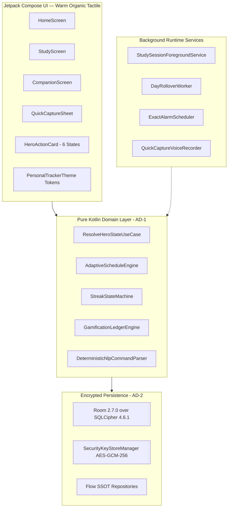

# HANDOFF.md — Personal-Tracker

## 1. Snapshot
*   **Project Name:** Personal-Tracker
*   **One-line Purpose:** Local-first, network-optional native Android personal productivity companion with SQLCipher encrypted persistence, pure Kotlin behavioral engines, voice quick-capture, and a non-punishing companion pet.
*   **Date/Time:** 2026-11-23 09:15:00 +05:30
*   **Current Git Commit:** Story 5.1 Complete — Tiered Notification Channels & Exact Alarm Scheduling Engine (Epic 5 In-Progress)
*   **Tech Stack & Versions:**
    *   **Language & Runtime:** Kotlin 2.1.0, JDK 21 (Eclipse Temurin 21.0.6 / JBR 21.0.11), Gradle 9.4+ / AGP 8.8.0
    *   **UI Toolkit:** Jetpack Compose BOM 2026.02.00, Material 3 (1.3.1), Warm Organic Tactile Design Language
    *   **Dependency Injection:** Hilt 2.58 (`ksp` only; zero KAPT)
    *   **Persistence & Security:** Room 2.7.0 (v3 with `MIGRATION_1_2` and `MIGRATION_2_3`) over SQLCipher 4.6.1 + SQLite 3.44.0, AndroidX Security Crypto 1.1.0-alpha06
    *   **Animation Runtimes:** Airbnb Lottie Compose 6.6.2 (`com.airbnb.android:lottie-compose`), Rive Android Runtime 9.1.0 (`app.rive:rive-android`)
    *   **Multi-Agent Plugins:** Elephant-Goldfish Model (EGM) Global Plugin (`C:\Users\User\.gemini\config\plugins\egm`)
*   **Commands to Build & Test:**
    *   Unit Tests (JVM): `.\gradlew test` (511 tests, passes clean with 0 errors)
    *   Android Lint: `.\gradlew lintDebug` (0 errors, verifies token & accessibility rules)
    *   Architecture Spine Linter: `python .agent/skills/bmad-architecture/scripts/lint_spine.py --workspace .` (`ok: true, total_findings: 0`)
    *   Domain Purity Linter: `python .agents/scripts/domain_purity_check.py` (`ALL ARCHITECTURAL PURITY CHECKS PASSED`)
    *   Harness² Baseline Check: `python .agents/scripts/harness2_bridge.py --check` (`All 8 H0 components valid`)
    *   Artemis Real-Device E2E Verification (Gate 6): Deploy with `.\gradlew installDebug`, then run autonomous exploration and diagnostics via Artemis MCP (`mobile_get_device_state`, `mobile_run_task --profile flash`, `mobile_diagnose`) on `com.personaltracker`.
    *   Assemble Debug APK: `.\gradlew assembleDebug`
    *   EGM Design & Drift Verification: Concept briefs and drift reports in `docs/designs/` (`/egm:egm-drift-report`)
*   **Overall Status:**
    *   **Epic 1 (Core Architecture & Persistence):** 100% Complete (`done`).
    *   **Epic 2 (Low-Friction Multimodal Capture & Confidence Routing Pipeline):** 100% Complete (`done`).
    *   **Epic 3 (Focus Mode, Distraction Interception & Resumption Engine):** 100% Complete (`done`).
    *   **Epic 4 (Gamification Economy, Streak State Machine & Non-Punishing Companion):** 100% Complete (`done`).
    *   **Epic 5 (Non-Punishing Notification & Escalation Engine):** In Progress (`in-progress`).
        *   **Story 5.1 (`5-1-tiered-notification-channels-exact-alarm-scheduling-engine`):** 100% Complete (`done`).
        *   **Story 5.2 (`5-2-acknowledgement-based-bounded-escalation-engine`):** Ready for Dev (`backlog` / next up).
    *   **Warm Organic Tactile Design System:** 100% Synchronized across all Figma frames, Framer prototypes, and Jetpack Compose screens.
    *   **Device Verification:** Verified offline-safe, crash-free, with Room v2->v3 migration passing clean.

---

## 2. Completed Work Today (2026-11-23)

### A. Story 5.1: Tiered Notification Channels & Exact Alarm Scheduling Engine
1. **Tiered Notification Manager (`TieredNotificationManager.kt`):**
   - Implemented singleton registering 3 Android notification channels for API 26+:
     - `channel_routine` (`IMPORTANCE_LOW`): Silent routine task reminders with zero heads-up interruption.
     - `channel_important` (`IMPORTANCE_DEFAULT`): Default importance, audible chime, no heads-up display.
     - `channel_urgent` (`IMPORTANCE_HIGH`): High importance, heads-up banner, and companion double-pulse vibration pattern (`[0, 250, 150, 250]`).
   - Added legacy channel purge (`task_reminders_channel`).
   - Added pure companion object static resolver `getChannelIdForIntensity(deliveryIntensity: String): String`.
2. **Defensive Alarm Scheduling Engine (`ExactAlarmScheduler.kt`):**
   - Tier-differentiated wakeup mechanics:
     - `ROUTINE`: Inexact wakeup via `setAndAllowWhileIdle()` (zero lock screen / status bar alarm clock icon).
     - `IMPORTANT`: Exact wakeup via `setExactAndAllowWhileIdle()`.
     - `URGENT`: Exact wakeup via `setAlarmClock()` (heads-up delivery and lockscreen alarm clock integration).
   - Defensive `SecurityException` catch at a single explicit boundary, falling back automatically to `scheduleInexactFallback(alarm)`.
   - Past-timestamp rejection (`triggerEpochMillis <= System.currentTimeMillis()`).
3. **Pure Domain & UI Wiring (`TaskAlarmScheduler.kt`, `SettingsViewModel.kt`, `SettingsScreen.kt`):**
   - Extended pure Kotlin domain interface `TaskAlarmScheduler` with `canScheduleExactAlarms(): Boolean` (AD-1).
   - Added `isExactAlarmGranted` and `isNotificationsEnabled` to `SettingsUiState`.
   - Built "Notifications & Alarm Timing" surface card in `SettingsScreen` with 100% `PersonalTrackerTheme` semantic tokens (AD-7) and 48dp minimum touch targets.
   - Deep-linked directly to `ACTION_REQUEST_SCHEDULE_EXACT_ALARM` and `ACTION_APP_NOTIFICATION_SETTINGS`.
4. **Elephant-Goldfish Model (EGM) Design & Review Gates:**
   - Authored specification `spec-5-1-tiered-notification-channels-exact-alarm-scheduling-engine.md`.
   - Executed 3-stage Goldfish review gate (`egm-comprehension`, `egm-design`, `egm-implementation-readiness`), resolving all findings into Iteration 2.
   - Compiled drift report `docs/designs/drift/drift-report-5-1.md` confirming 100% specification conformance and 0.0% drift.

---

## 3. Current Architecture & Verification Status



### Verification Gate Results
*   **`python .agents/scripts/domain_purity_check.py`:** **PASSED** (0 `android.*` in domain, 0 raw hex in UI)
*   **`python .agent/skills/bmad-architecture/scripts/lint_spine.py --workspace .`:** **PASSED** (0 findings)
*   **`.\gradlew test`:** **PASSED** (All 511 JVM unit tests passing)
*   **`.\gradlew lintDebug`:** **PASSED** (0 errors)
*   **Gate 6 (Artemis E2E Real-Device Verification):** **CONFIGURED** (`tools/artemis`, `.agents/rules/artemis-mobile-testing.md`, `.agents/mcp_config.json`)
*   **`adb install` & Launch:** **PASSED** (Verified on physical device `10BD9D24YF000BE`)
*   **Graphify Knowledge Graph:** **CURRENT** (`graphify update .` completed)
*   **Git Status:** **CLEAN** (Commit ready on `origin/main`)

---

## 4. Pending Work & Roadmap

### Completed Epic: Epic 2 — Low-Friction Multimodal Capture & Confidence Routing Pipeline (100% DONE)
*   [x] **Story 2.1:** Morphing voice capture FAB & audio input lifecycle (Framer spring physics `fabToModalSpringSpec`, RAM-only streaming audio, zero disk writes, 3-tier confidence UI). `[DONE]`
*   [x] **Story 2.2:** Deterministic Kotlin regex & rule NLP parser (<300ms latency on `Dispatchers.Default`, title/date/time/duration/intensity extraction). `[DONE]`
*   [x] **Story 2.3:** Dual voice engine & network failover architecture (Gemini Live WebSocket streaming with seamless on-device SpeechRecognizer failover). `[DONE]`
*   [x] **Story 2.4:** Strict AI action boundary & command validation pipeline (unvalidated proposal gate, 0 direct Room DAO mutations from AI/speech, temporal safety, relational integrity, task deduplication, confidence downgrade handshake). `[DONE]`
*   [x] **Story 2.5:** Three-tier confidence routing with 5-second instant commit undo toast and unfiled triage inbox. `[DONE]`

### Completed Epic: Epic 3 — Focus Mode, Distraction Interception & Resumption Engine (100% DONE)
*   [x] **Story 3.1:** Focus study session models, timer & heatmap tracking (`3-1-focus-study-session-models-timer-heatmap-tracking`, interval classification `FocusIntervalType`, Pomodoro cycle escalation in `FocusRescheduleEngine`, 28-day 5-tier contribution heatmap in `HeatmapLedgerEngine`, MVI integration). `[DONE]`
*   [x] **Story 3.2:** Event-driven accessibility distraction interception & privacy (`3-2-event-driven-accessibility-distraction-interception-privacy`, privacy-first AccessibilityService, `canRetrieveWindowContent = false`, `TYPE_WINDOW_STATE_CHANGED` filter, pure Kotlin `InterceptDistractionUseCase`, Warm Organic Tactile `InterventionOverlay` & `InterventionCard` via `OverlayLifecycleOwner`, Settings MVI permission checks). `[DONE]`
*   [x] **Story 3.3:** Emergency telecom dynamic whitelist bypass (`3-3-emergency-telecom-dynamic-whitelist-bypass`, unconditional emergency/dialer exemption, dynamic TelecomManager default dialer bypass, telephony call listener overlay dismissal, pure Kotlin whitelist CRUD interactors, Settings MVI whitelist manager & call progression policy). `[DONE]`
*   [x] **Story 3.4:** Frictionless Interruption Handling & Zero-Guilt Resumption (`3-4-frictionless-interruption-handling-zero-guilt-resumption`, Ovsiankina resumption engine, Room v1->v2 migration `MIGRATION_1_2`, `NonCancellable` persistence in `StudySessionForegroundService`, 3-action `InterventionOverlay` wiring, Priority 2 dual-mode `HeroActionCard`, and Warm Organic Tactile Resumption Card). `[DONE]`

### Completed Epic: Epic 4 — Gamification Economy, Streak State Machine & Non-Punishing Companion (100% DONE)
*   [x] **Story 4.1:** Habit entity models, cadence tracking & streak grace engine (`4-1-habit-entity-models-cadence-tracking-streak-grace-engine`, pure Kotlin cadence hierarchy `Daily`, `SpecificDays`, `WeeklyFrequency`, 5-state flame model with `FlameState.GRACE_SHIELD`, `StreakStateMachine` off-cadence & `DayType` immunity, `EvaluateHabitStreaksUseCase`, Room v2->v3 migration `MIGRATION_2_3`, dynamic `VerticalCapsuleBars` MVI wiring). `[DONE]`
*   [x] **Story 4.2:** Idempotent coin ledger engine & anti-farming model (`4-2-idempotent-coin-ledger-engine-anti-farming-model`, pure Kotlin `GamificationLedgerEngine`, anti-farming caps `DAILY_TASK_CAP = 50`, `DAILY_HABIT_CAP = 40`, `DAILY_FOCUS_CAP = 120`, `DAILY_GLOBAL_FARMABLE_CAP = 100`, gross spend defense `deltaAmount > 0`, non-negative clawbacks, compound idempotency keys, single-transaction atomicity in Room `@Transaction`, semantic `CoinPill`). `[DONE]`
*   [x] **Story 4.3:** VSync-aligned Bézier coin-earn animation & Coin HUD (`4-3-vsync-aligned-bézier-coin-earn-animation-coin-hud`, quadratic Bézier trajectory engine, RenderThread graphicsLayer transforms, arrival coordination, concurrent burst stages). `[DONE]`
*   [x] **Story 4.4:** Non-punishing companion widget & 7-state Rive machine (`4-4-non-punishing-companion-widget-7-state-rive-machine`, canonical 7-state `CompanionState(0..6)` matching Rive inputs, DayType rest immunity, atomic cosmetics purchase & equip engine, catalog auto-seeding, 48dp minimum touch target floor, interactive home avatar badge). `[DONE]`
*   [x] **Story 4.5:** Cosmetics wardrobe shop, consumable grace shields & milestone choreography (`4-5-cosmetic-shop-ui-companion-customization`, consumable Grace Shields / Slack Bank Days capped at 3, atomic coin deduction and cap enforcement in `HabitRepository.purchaseStreakShield`, dynamic fallback habit selection in `PurchaseStreakShieldUseCase`, unclipped modal milestone celebration in `RewardMotionStage`, 7-day consistency milestone companion celebrations `CompanionState.CELEBRATING_REWARD`, strict reduced-motion bypass). `[DONE]`

### Epic 5: Local Privacy, Encryption & Non-Punishing Notifications (In Progress)
*   [x] **Story 5.1:** Tiered notification channels & exact alarm scheduling engine (`5-1-tiered-notification-channels-exact-alarm-scheduling-engine`, `TieredNotificationManager`, `channel_routine` [LOW], `channel_important` [DEFAULT], `channel_urgent` [HIGH], tier-differentiated wakeups, `ExactAlarmScheduler` defensive `SecurityException` fallback, `TaskAlarmScheduler.canScheduleExactAlarms()`, Settings MVI deep-links). `[DONE]`
*   [ ] **Story 5.2:** Acknowledgement-based bounded escalation engine (`5-2-acknowledgement-based-bounded-escalation-engine`, bounded nudge sequences, escalation caps, non-punishing dismissals). `[READY FOR DEV]`
*   [ ] **Story 5.3:** Urgency soft-cap scarcity guidance (`5-3-urgency-soft-cap-scarcity-guidance`). `[BACKLOG]`
*   [ ] **Story 5.4:** Evening/morning carry-forward review card (`5-4-evening-morning-carry-forward-review-card`). `[BACKLOG]`
*   [ ] **Story 5.5:** Advisory workload capacity indicator guardrails (`5-5-advisory-workload-capacity-indicator-guardrails`). `[BACKLOG]`

---

## 5. Next Session Kickoff Runbook

### Step 1: Health & Workspace Verification
```powershell
git status
python .agents/scripts/domain_purity_check.py
python .agent/skills/bmad-architecture/scripts/lint_spine.py --workspace .
$env:JAVA_HOME = "C:\Users\User\.jdks\jbr-21.0.11"
.\gradlew test
```

### Step 2: Kick off Story 5.2 Implementation with EGM & BMAD Build
```
/bmad-build 5-2-acknowledgement-based-bounded-escalation-engine
```
1. **The Elephant:** Hold full context (`docs/okf/index.md`, `ARCHITECTURE-SPINE.md`, `.harness2/EXPERIENCE.md`, `HANDOFF.md`) to design `spec-5-2-*.md` under the strict "No Code During Design" rule (`/egm:egm-brainstorm` & `/egm:egm-draft`).
2. **The Goldfish Swarm:** Dispatch isolated spec to stateless subagents (`/egm:egm-review`) for the 3-stage gate: Comprehension check, Antagonistic review (`AD-1`..`AD-8`), and Implementation Readiness Go/No-Go.
3. **Implementation & Verification:** Implement via `invoke_subagent` (`Workspace: "inherit"`), verify JVM tests and Artemis Gate 6, and run `/egm:egm-drift-report` to confirm 0 drift.
