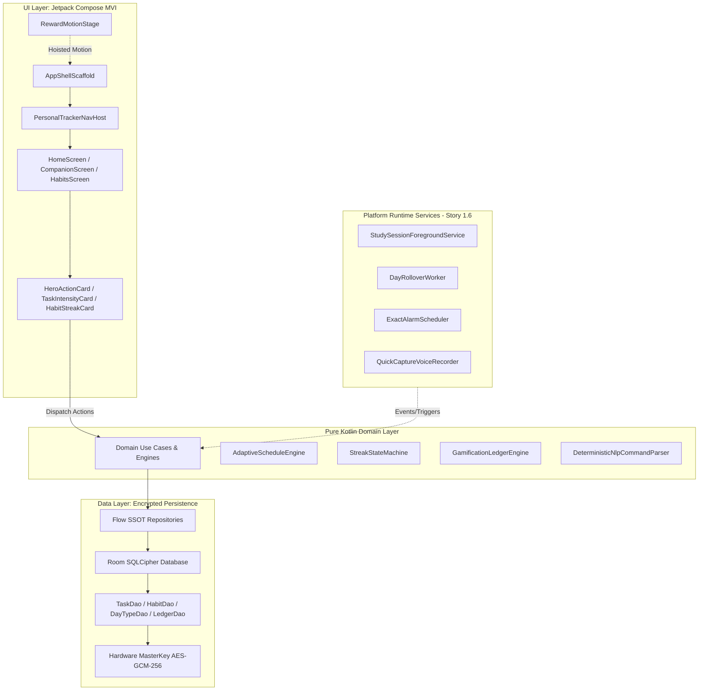

# HANDOFF.md — Personal-Tracker

## 1. Snapshot
*   **Project Name:** Personal-Tracker
*   **One-line Purpose:** Local-first, network-optional native Android personal productivity companion with SQLCipher encrypted persistence, pure Kotlin behavioral engines, voice quick-capture, and a non-punishing companion pet.
*   **Date/Time:** 2026-10-23 11:10:00 +05:30
*   **Tech Stack & Versions:**
    *   **Language & Runtime:** Kotlin 2.1.0, JDK 21 (Eclipse Temurin 21.0.6), Gradle 9.4+ / AGP 8.8.0
    *   **UI Toolkit:** Jetpack Compose BOM 2026.02.00, Material 3 (1.3.1)
    *   **Dependency Injection:** Hilt 2.58 (`ksp` only; zero KAPT)
    *   **Persistence & Security:** Room 2.7.0 over SQLCipher 4.6.1 + SQLite 3.44.0, AndroidX Security Crypto 1.1.0-alpha06
    *   **Animation Runtimes:** Airbnb Lottie Compose 6.6.2 (`com.airbnb.android:lottie-compose`), Rive Android Runtime 9.1.0 (`app.rive:rive-android`)
*   **Commands to Build & Test:**
    *   Unit Tests (JVM): `.\gradlew test` (174 tests, ~1m 30s, passes clean)
    *   Android Lint: `.\gradlew lintDebug` (0 errors, verifies token & accessibility rules)
    *   Architecture Spine Linter: `python .agent/skills/bmad-architecture/scripts/lint_spine.py --workspace .` (`ok: true, total_findings: 0`)
    *   Domain Purity Linter: `python .agents/scripts/domain_purity_check.py` (`ALL ARCHITECTURAL PURITY CHECKS PASSED`)
    *   Assemble Debug APK: `.\gradlew assembleDebug`
    *   Install & Launch on Connected Device:
        ```powershell
        & "C:\Users\User\AppData\Local\Android\Sdk\platform-tools\adb.exe" -s 10BD9D24YF000BE install -r app\build\outputs\apk\debug\app-debug.apk
        & "C:\Users\User\AppData\Local\Android\Sdk\platform-tools\adb.exe" -s 10BD9D24YF000BE shell am start -n com.personaltracker/.MainActivity
        ```
*   **Overall Status:** Phase: Epic 1 Core Architecture & Persistence (~65% of Epic 1 completed). Stories 1.1 through 1.7 fully implemented and verified; JVM unit tests (174 executed) and Android lint pass with 0 errors.

---

## 2. Goal & Requirements
*   **Core Goal:** High-performance, offline-first productivity assistant managing flexible daily schedules, study focus timers, habit streaks, sequential routines, and voice quick-capture with 0-guilt psychological safety.
*   **Hard Requirements & Invariants (`ARCHITECTURE-SPINE.md`):**
    *   **AD-1 / AD-3 (Domain Purity):** `com.personaltracker.domain` must be 100% pure Kotlin. Never import `android.*` or `androidx.*`.
    *   **AD-2 (Persistence Integrity):** Multi-entity mutations across boundaries must execute inside Room `@Transaction` blocks on `Dispatchers.IO`. Never use `OnConflictStrategy.REPLACE` on entities with cascade foreign keys (use `@Upsert` or `@Insert(onConflict = ABORT)`).
    *   **AD-4 (Non-Punishing Copy & Mechanics):** Zero nag or guilt copy in UI or notifications. Companion pet has 0 HP loss, hunger decay, or death mechanics. Missed habits freeze peacefully.
    *   **AD-7 (Strict Token Conformance):** Zero hardcoded `dp`, `sp`, or hex color literals in Compose UI. Resolve exclusively from `com.personaltracker.ui.theme`. Minimum interactive touch target is 48dp floor (`spacing.minTouchTarget`). Particle/arc animations must be hoisted to `RewardMotionStage` at root scaffold.
    *   **AD-8 (Confidence Routing):** High (>=0.85): 5s bottom undo toast. Medium (0.50..0.85): 1-tap confirmation chips. Low (<0.50): unfiled inbox. Voice audio streams to RAM only; raw buffers must be purged immediately after transcription with zero disk writes.
*   **User Preferences:**
    *   Strict adherence to pre-approved architecture specs.
    *   Never modify code while conducting live device testing unless reviewing results first.
    *   Verify all changes with `.\gradlew test` and `.\gradlew lintDebug`.

---

## 3. Flow

### Architecture & Data Flow


### User Flow
1.  **Launch:** Opens to `AppShellScaffold` with Persistent Top Context Bar (`DayTypeChip`, `StreakFlameBadge`, `CoinPill`).
2.  **Home Feed:** `HeroActionCard` evaluates priority (ActiveFocus -> InterruptedResumable -> MorningBanner -> UpcomingItem -> CarryForwardReview -> IntentionalIdle).
3.  **Task & Habit Actions:** Tapping complete triggers quadratic Bézier `CoinArcAnimation` with `withFrameNanos` VSYNC timing straight to top-right `CoinPill` HUD, plus Lottie `CoinEarnMicro` gold burst.
4.  **Quick Capture:** Tap bottom-right floating FAB -> `QuickCaptureSheet` emerges with dynamic waveform or text input -> parses command via `DeterministicNlpCommandParser` -> routes via 3-tier confidence model.
5.  **Companion & Rewards:** 4th bottom nav tab opens `CompanionScreen` hosting `CompanionView` (Rive `companion_sm` across 7 non-punitive emotional registers) and Lottie `MilestoneFullReveal` confetti celebration.

### Work Flow & Phasing
*   **Phase 1 (Foundations):** Story 1.1 (Setup) -> Story 1.2 (SQLCipher) -> Story 1.3 (SSOT Repos) -> Story 1.4 (Pure Engines) -> Story 1.5 (UI Shell & Components) — **ALL COMPLETE & REVIEWED**.
*   **Phase 2 (Platform & Background):** Story 1.6 (`com.personaltracker.platform` runtime services) — **CURRENT / NEXT UP**.
*   **Phase 3 (Screen Wiring):** Story 1.7 (MVI ViewModels binding UI cards to live Flow SSOT repositories).
*   **Phase 4 (Schedules & Voice):** Stories 1.8 - 1.11, then Epic 2 (Voice Quick Capture).

---

## 4. Completed Work

| Item | Files Touched | Status | Notes |
| :--- | :--- | :--- | :--- |
| **Story 1.1: Project Setup & Theme** | `app/build.gradle.kts`, `ui/theme/*` | Done | Kotlin 2.1, Compose BOM, strict theme tokens (`Color`, `Type`, `Spacing`, `Shape`, `Elevation`). |
| **Story 1.2: SQLCipher Persistence** | `data/local/db/*`, `data/local/security/*` | Done | Encrypted Room database with SQLCipher 4.6.1 and Android Keystore AES-GCM master key. |
| **Story 1.3: SSOT Repositories & Idempotency** | `data/repository/*`, `data/local/db/daos/*` | Done | Reactive Flow repositories, compound idempotency keys (`{DOMAIN}_{ACTION}_{ID}`), `@Upsert` patterns. |
| **Story 1.4: Pure Behavioral Engines** | `domain/engine/*`, `domain/parser/*` | Done | `AdaptiveScheduleEngine`, `FocusRescheduleEngine`, `GamificationLedgerEngine`, `StreakStateMachine`, `DeterministicNlpCommandParser`. |
| **Story 1.5: Atomic Primitives** | `ui/components/atoms/*` | Done | `StreakFlameBadge`, `CoinPill`, `DayTypeChip`, `WaveformVisualizer`. 48dp touch target floors. |
| **Story 1.5: Molecular Cards** | `ui/components/cards/*` | Done | `HeroActionCard` (6 states), `HabitStreakCard`, `AdaptiveRoutineStepCard`, `TaskIntensityCard` (Urgent/Important/Routine). |
| **Story 1.5: Overlays & Shell** | `ui/components/overlays/*`, `ui/navigation/*` | Done | `QuickCaptureSheet` (3-tier confidence), `AppShellScaffold`, `PersonalTrackerNavHost`. |
| **Story 1.5: Animation Systems** | `ui/components/animation/*`, `ui/components/companion/*` | Done | `CoinArcAnimation` (VSYNC Bézier), `RewardAnimation` (Lottie), `RewardMotionStage`, `CompanionView` (Rive 7-state). |
| **UI Integration & Polish** | `ui/screens/HomeScreen.kt`, `ui/screens/CompanionScreen.kt` | Done | Wired interactive cards, Rive state machine switcher, and coin arc reward triggers. |
| **Story 1.6: Platform Runtime Services & Background Workers** | `platform/*`, `di/PlatformModule.kt`, `AndroidManifest.xml` | Done | `StudySessionForegroundService`, `DayRolloverWorker`, `ExactAlarmScheduler`, `QuickCaptureVoiceRecorder` (RAM-only zeroing), `BootCompletedReceiver`. 100% pure domain preserved. |
| **Story 1.7: Unidirectional MVI Screen Wiring & ViewModels Baseline** | `ui/screens/*`, `ui/navigation/*`, `app/src/test/java/com/personaltracker/ui/*` | Done | Full MVI ViewModels (`HomeViewModel`, `CompanionViewModel`, `QuickCaptureViewModel`, `HabitsViewModel`, `StudyViewModel`, `SettingsViewModel`, `AppShellViewModel`). Figma-ready Route/ScreenContent split, 3-tier quick capture routing, 6-state Hero Card hierarchy, pure domain & zero hardcoded token compliance. |
| **Story 1.8: DayType Schedule Resolution & Morning Template Swap** | `domain/model/DayType.kt`, `domain/usecase/SwitchDayTypeUseCase.kt`, `data/repository/DayTypeRepositoryImpl.kt`, `ui/components/overlays/DayTypeSelectorDialog.kt`, `ui/screens/home/*` | Done | Built-in template provisioning (Standard, Rest, Crunch, Low Capacity), 4-tier resolution hierarchy, non-destructive schedule adaptation, atomic single-date override persistence, 48dp minimum touch target dialog, and reactive MVI wiring with zero guilt copy. |

---

## 5. In Progress
*   **Currently Paused At:** Completion and verification of Story 1.8. All unit tests (190+ tests), Android lint, domain purity, and architecture spine checks passed with 0 errors.
*   **Exact Next Step:** Begin **Story 1.9 (`1-9-dynamic-state-aware-hero-card-integration-action-list`)**.
    *   Target: Dynamic state-aware Hero Card integration with subordinate action list and carry-forward reviews.

---

## 6. Pending Work (Prioritized)

### P0: Story 1.9 — Dynamic State-Aware Hero Card Integration & Action List
*   **Goal:** Bind dynamic Hero Card 6-state machine to today's schedule and action list with 300ms cross-fade animations and intentional idle resting state.
*   **Blockers:** None.

### P1: Stories 1.10 – 1.11 (Epic 1 Completion)
*   **1.10:** Core task management & delivery intensity classification.
*   **1.11:** Sequential routine domain engine & mid-day schedule recalculation.

---

## 7. Changes Needed
*   `app/src/main/assets/rive/companion.riv`: Artist binary asset is currently absent. `CompanionView.kt` currently falls back to `PlaceholderCompanionView`. When production `.riv` is ready, place in `res/raw/companion.riv` or `assets/rive/companion.riv` (no code changes needed).
*   `ui/screens/*`: All feature screens now fully refactored to production MVI ViewModels (`*Route` / `*ScreenContent` split) in Story 1.7.

---

## 8. Decisions & Rationale
*   **JDK 21 Pinning:** Gradle execution daemon must use JDK 21 (Temurin 21.0.6). Java 26 on PATH breaks Android Gradle Plugin sync.
*   **KSP Exclusive:** KAPT is prohibited across all modules; only `ksp` is used for Hilt and Room code generation.
*   **`withFrameNanos` Bézier Curve (`CoinArcAnimation.kt`):** Monotonic frame clock sync prevents animations from running twice as fast on 120Hz displays (such as the physical iQOO test device) or stuttering on 60Hz displays.
*   **Root Scaffold Hoisting (`RewardMotionStage.kt`):** Hoisting particle layers to `AppShellScaffold` prevents modal clipping and scroll-boundary truncation.
*   **No SQLite Cascade Replacement:** Entities with foreign keys use `@Upsert` or `@Insert(onConflict = ABORT)` to avoid silent deletion of child logs.

---

## 9. Known Issues & Gotchas
*   **PowerShell Binary Redirection:** Running `adb exec-out screencap -p > file.png` in PowerShell creates a UTF-16LE file that corrupts binary images. **Always use:**
    ```powershell
    adb shell screencap -p /sdcard/temp.png; adb pull /sdcard/temp.png local_path.png
    ```
*   **Touch Targets:** Android Lint flags any interactive composable under 48dp. Always specify `.defaultMinSize(minWidth = spacing.minTouchTarget, minHeight = spacing.minTouchTarget)` or ensure visual chips expand their hit target to 48dp.
*   **Pure Kotlin Domain:** Never import `androidx.compose.*`, `android.os.*`, or `android.content.*` in `com.personaltracker.domain`.

---

## 10. File Map

| Path | Purpose | Role |
| :--- | :--- | :--- |
| `ARCHITECTURE-SPINE.md` | Invariant rules (AD-1 to AD-8), layer boundaries | **Source of Truth** |
| `_bmad-output/project-context.md` | Architectural rules, pitfalls, and guidelines | **Source of Truth** |
| `_bmad-output/planning-artifacts/epics.md` | Epics and Stories definitions | **Source of Truth** |
| `_bmad-output/implementation-artifacts/sprint-status.yaml` | Sprint tracker | **Source of Truth** |
| `app/build.gradle.kts` | App module dependencies & build configuration | Active Build File |
| `app/src/main/java/com/personaltracker/domain/` | Pure Kotlin models, engines, and use cases | Pure Domain (Do NOT add Android imports) |
| `app/src/main/java/com/personaltracker/data/` | SQLCipher Room DB, DAOs, Entities, Repositories | Persistence SSOT |
| `app/src/main/java/com/personaltracker/ui/theme/` | Design tokens (`Color`, `Type`, `Spacing`, `Shape`) | Theme Tokens (No hardcoded literals allowed) |
| `app/src/main/java/com/personaltracker/ui/components/` | Atoms, cards, overlays, animations | Atomic Component Library |
| `app/src/main/java/com/personaltracker/ui/navigation/` | `AppShellScaffold`, `PersonalTrackerNavHost` | Navigation & Shell Container |
| `app/src/main/java/com/personaltracker/ui/screens/` | Top-level tab screens | UI Screens |
| `app/src/main/java/com/personaltracker/platform/` | Foreground services, workers, alarms, audio | Story 1.6 Target Directory |

---

## 11. Open Questions
*   **Offline Voice Transcription Model (Epic 2):** Vosk vs. Whisper.tflite for on-device zero-latency speech-to-text.
    *   *Default recommendation:* Vosk Android SDK (lightweight, zero network dependency, runs efficiently on device).
*   **Production Rive Asset Delivery:** The `.riv` file for companion expressions is currently mocked via `PlaceholderCompanionView`.
    *   *Default recommendation:* Keep `PlaceholderCompanionView` active until production asset is delivered.

---

## 12. Next Session Kickoff

### First 4 Concrete Actions:
1.  **Verify Environment & Health:**
    ```powershell
    git status
    .\gradlew test
    python .agent/skills/bmad-architecture/scripts/lint_spine.py --workspace .
    python .agents/scripts/harness2_bridge.py --check
    ```
2.  **Inspect Story 1.8 Requirements:** Read `epics.md` § Story 1.8 (`DayType Schedule Resolution & Morning Template Swap`).
3.  **Execute Story 1.8 Plan:** Generate `spec-1-8-daytype-schedule-resolution-morning-template-swap.md` and implement date-specific user overrides and morning template swap dialog.
4.  **Wire to Home & Settings:** Integrate morning template swap banner with `HomeViewModel` and `DayTypeChip`.

### Kickoff Verification Checklist:
*   [ ] Read this `HANDOFF.md` completely.
*   [ ] Follow the sequence in the Flow section.
*   [ ] Do not alter any existing design tokens or domain invariants without consulting `ARCHITECTURE-SPINE.md`.
*   [ ] Run `.\gradlew test` and `.\gradlew lintDebug` after modifications.
