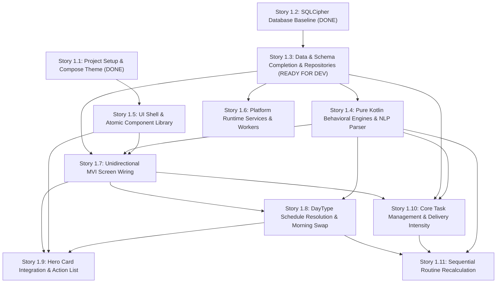

# Epic 1 Context: Project Foundation, Architectural Substrate & Core Home Experience

<!-- Compiled from planning artifacts. Aligned with ARCHITECTURE-SPINE.md (AD-1 to AD-8) and project-context.md. -->

## Goal

Establish the complete 4-layer MVI architectural substrate for Personal-Tracker v1, unifying encrypted SQLite persistence (Room over SQLCipher with Android Keystore master key), pure Kotlin deterministic behavioral engines (schedule adaptation, non-punitive streaks, gamification ledger, focus rescheduling, intervention rules, NLP parser), platform background runtime services (foreground focus timer, midnight rollover worker, exact alarm scheduler, voice recorder), UI shell & token-strict component library (AppShellScaffold, Top Context Bar, hoisted RewardMotionStage, QuickCaptureSheet, Hero Card state machine), and reactive MVI screen wiring before executing core DayType, Task, and Routine feature workflows.

## Stories

- **Story 1.1: Android Greenfield Project Setup, Compose Theme & Design Tokens** `[DONE]`
  - Pinned toolchain (Kotlin 2.1.0, JDK 21, Compose BOM 2026.02.00, Hilt 2.58).
  - Material 3 theme tokens (`ui/theme/`), 5-tab bottom navigation host (`ui/navigation/`), and reward animations (`ui/components/animation/`).
- **Story 1.2: SQLCipher Encrypted Database Baseline & Master Key Management** `[DONE]`
  - Hardware-isolated Keystore master key (`PersonalTracker_MasterDB_Key`, AES-256-GCM), 32-byte vault passphrase in `pt_db_vault.bin`.
  - Room 2.7.0 over SQLCipher 4.6.1 with PBKDF2 256,000 iterations, 4096-byte page size, 16KB native ELF alignment.
  - Initial 8 Room entities and 9 internal DAOs dispatching on `Dispatchers.IO`.
- **Story 1.3: Data & Schema Completion, Flow-Based SSOT Repositories & Idempotency Architecture** `[READY FOR DEV]`
  - Add standalone `InterventionRuleEntity.kt` in `data/local/db/entities/` to match `InterventionRuleDao.kt`.
  - Establish completion audit log entity support (`HabitLogEntity`, `StudySessionEntity`, and task completion timestamps).
  - Implement Flow-based Single Source of Truth (SSOT) Repositories in `data/repository/` (`DayTypeRepository`, `TaskRepository`, `RoutineRepository`, `HabitRepository`, `StudySessionRepository`, `EconomyRepository`, `UnfiledInboxRepository`, `InterventionRuleRepository`).
  - Enforce compound `{DOMAIN}_{ACTION}_{ID}` idempotency keys on all coin transactions and Room `@Transaction` boundaries on `Dispatchers.IO` (AD-1, AD-4, AD-5, AD-6).
- **Story 1.4: Pure Kotlin Behavioral Engines & Deterministic NLP Command Parser** `[BACKLOG]`
  - Pure Kotlin implementations in `domain/engine/` and `domain/parser/` with ZERO `android.*` or `androidx.*` imports (AD-1, AD-3).
  - `AdaptiveScheduleEngine`: Dynamically scale routine durations, step schedules, and study targets across DayType template swaps.
  - `StreakStateMachine`: 4-state flame (`COLD` -> `WARMING` -> `BURNING` -> `BLAZING`) with miss-tolerant slack banking and freeze grace rules (AD-4).
  - `GamificationLedgerEngine`: Calculate coin rewards, validate anti-farming constraints, generate `{DOMAIN}_{ACTION}_{ID}` idempotency keys, and update companion energy.
  - `FocusRescheduleEngine`: Recalibrate remaining study blocks upon pauses or interruptions without guilt copy.
  - `InterventionRuleEngine`: Evaluate distraction rule cooldowns to generate single-prompt JITAI nudges.
  - `NaturalLanguageCommandParser` & `ConfidenceScorer`: Deterministic regex/rule parser on `Dispatchers.Default` (< 300ms) with 3-tier confidence scoring (High >= 0.85, Medium 0.50–0.84, Low < 0.50; AD-8).
- **Story 1.5: UI Shell & Atomic Component Library** `[BACKLOG]`
  - Global `AppShellScaffold` with persistent Top Context Bar (`DayTypeChip`, `StreakFlameBadge`, live `CoinPill` target coordinates).
  - Root-level hoisted `RewardMotionStage` preventing animation viewport clipping (`CoinArcAnimation`, milestone celebrations per AD-7).
  - Floating `QuickCaptureSheet` with live `WaveformVisualizer` amplitude streaming and dual voice/text inputs.
  - Dynamic `HeroCard` 6-state container machine (Active Focus, Interrupted/Resumable, Morning DayType Banner, Upcoming Scheduled Item, Carry-Forward Review, Intentional Idle) with 300ms `FastOutSlowIn` transitions.
  - Token-strict atomic domain components (`TaskCard`, `RoutineCard`, `HabitCard`) with 48dp minimum touch target floor.
- **Story 1.6: Platform Runtime Services & Background Workers** `[BACKLOG]`
  - `StudySessionForegroundService` in `platform/timer/` managing high-precision countdown timers with lock-screen notification action intents (AD-1).
  - `DayRolloverWorker` in `platform/worker/` via `WorkManager` executing at custom midnight boundary for routine rollover and streak evaluation.
  - `ExactAlarmScheduler` in `platform/alarm/` scheduling tiered notifications via `AlarmManager.setAlarmClock()` without polling (NFR-3).
  - `QuickCaptureVoiceRecorder` in `platform/voice/` streaming microphone audio to memory buffers and immediately purging raw audio post-transcription (AD-8, NFR-4).
  - `BootCompletedReceiver` restoring alarms and reconstructing interrupted focus sessions upon device reboot (ARCH-8).
- **Story 1.7: Unidirectional MVI Screen Wiring & ViewModels Baseline** `[BACKLOG]`
  - Standardized immutable MVI contracts (`UiState`, `UiIntent`, Channel-backed `Flow<UiEffect>`) and ViewModels for all 5 primary screens (`HomeScreen`, `HabitsScreen`, `StudyScreen`, `CompanionScreen`, `SettingsScreen`) per AD-2.
  - ViewModels consume data exclusively through Repository Flow interfaces and Domain Engines (AD-1).
  - Stateless screen composables wired to `AppShellScaffold` and `PersonalTrackerNavHost`.
- **Story 1.8: DayType Schedule Resolution & Morning Template Swap** `[BACKLOG]`
  - `ResolveDayTypeUseCase` evaluating hierarchy: `1) Date-Specific User Override > 2) Day-of-Week Default` with zero mandatory taps (FR-3.1, FR-3.2).
  - Non-blocking morning DayType banner on Home with 1-tap single-date swap saving `DayOverrideEntity` (FR-3.3, FR-3.4).
- **Story 1.9: Dynamic State-Aware Hero Card Integration & Action List** `[BACKLOG]`
  - Wire live repository data streams into `HeroCard` priority state evaluations (FR-1.1, UX-DR2).
  - Subordinate Today's Schedule and Action List views beneath the Hero Card (FR-1.2).
- **Story 1.10: Core Task Management & Delivery-Intensity Classification** `[BACKLOG]`
  - Task CRUD and delivery intensity classes (`ROUTINE`, `IMPORTANT`, `URGENT`) with accent stripes (FR-2.1, FR-2.2, UX-DR4).
  - Task completion state transitions with strikethrough text, haptic pulse, and idempotent coin reward dispatch (`TASK_COMP_<id>`) to `RewardMotionStage`.
- **Story 1.11: Sequential Routine Domain Engine & Mid-Day Schedule Recalculation** `[BACKLOG]`
  - Sequential step progression execution bound to DayType templates (FR-2.3).
  - Mid-day swap recalculation preserving completed/in-progress items as immutable historical records (FR-3.5, PRD Rule 4).
  - Persistent bottom sheet timeline (Peek ~100dp, Half ~50%, Full ~100%) updating unstarted blocks (UX-DR3).

## Requirements & Constraints

- **Latency & Performance:** Cold launch to interactive Hero Card < 1.5s on modern hardware (NFR-1). Quick-add deterministic NLP parse < 300ms on `Dispatchers.Default`.
- **Offline Integrity:** 100% of core tracking, schedule resolution, routine execution, and cryptographic storage operates offline without network connectivity (NFR-2).
- **Database & Security:** Database encrypted at rest using SQLCipher 4.6.1 with PBKDF2-HMAC-SHA512 (256,000 iterations), 4096-byte page size, and 16 KB native ELF page alignment (AD-5, NFR-4).
- **Master Key Lifecycle:** Master key managed via Android Keystore (`AES-256-GCM`, `setUserAuthenticationRequired(false)`). Vault passphrase encrypted in `pt_db_vault.bin`.
- **Pure Domain Boundary:** The `com.personaltracker.domain` layer contains zero Android framework dependencies (`android.*`, `androidx.*`) and unit-tests 100% on JVM without Robolectric (AD-1, AD-3).
- **Non-Punitive Mechanics:** Missed days never drop streaks directly to zero when slack bank or freeze days are available. Companion pet has zero HP loss, hunger decay, or death mechanics (AD-4).
- **Idempotent Rewards:** Every coin earning or deduction must be committed to `CoinLedgerEntity` with a deterministic, unique compound `idempotencyKey` (`{DOMAIN}_{ACTION}_{ID}`).
- **Strict Token Consumption:** Zero hardcoded colors, `dp`, or `sp` literals in UI composables; resolve exclusively from `com.personaltracker.ui.theme` tokens. Minimum interactive touch target is 48dp floor (AD-7).
- **Viewport-Hoisted Animations:** Reward particle and coin arc animations hoisted to `RewardMotionStage` at root scaffold level to prevent viewport clipping (AD-7).

## Technical Decisions

- **Target Platform:** Android 13–16 (Min SDK 33, Target SDK 36, Compile SDK 36).
- **Languages & Frameworks:** Kotlin 2.1.0, Jetpack Compose BOM 2026.02.00, Material 3 foundation with custom token extensions.
- **Dependency Injection:** Hilt DI (`com.google.dagger:hilt-android:2.58`) using centralized modules (`DatabaseModule`, `RepositoryModule`, `DomainEngineModule`, `PlatformModule`).
- **Persistence & Cryptography:** Room 2.7.0 over SQLCipher 4.6.1, Keystore AES-256-GCM master key, and `pt_db_vault.bin`.
- **Threading Rules:** Compose UI rendering on `Dispatchers.Main`, DB/Crypto/IO operations on `Dispatchers.IO`, deterministic regex, state machines, and Bézier curves on `Dispatchers.Default`.
- **Package Architecture:**
  - `ui/`: MVI presentation, theme tokens, components, screens, overlays.
  - `domain/`: Pure Kotlin models, behavioral engines, command parsers, use cases.
  - `data/`: Repositories (SSOT), Room database, DAOs, entities, Keystore crypto.
  - `platform/`: Android foreground services, WorkManager workers, exact alarm schedulers, microphone voice recording.

## UX & Interaction Patterns

- **Top Context Bar:** Persistent header displaying active DayType chip, streak flame badge, and live coin pill target coordinates.
- **Hero Card Priority States:** 1) Active Focus/Task, 2) Interrupted/Resumable, 3) Morning DayType Banner, 4) Upcoming Scheduled Item, 5) Carry-Forward Review, 6) Intentional Idle State with 300ms `FastOutSlowIn` transitions.
- **Persistent Bottom Sheet Timeline:** DayType timeline with Peek (~100dp), Half (~50%), Full (~100%) snap points above bottom navigation on Home surface.
- **Typography:** Plus Jakarta Sans for UI text, Inter for tabular numbers and timers.
- **Theme Parity:** Equal Light and Dark mode contrast compliance (WCAG 2.1 AA).

## Cross-Story Dependencies

