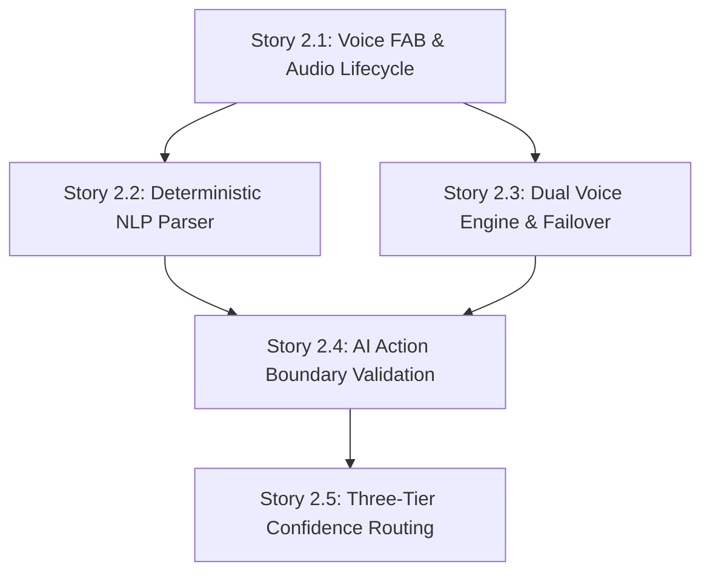

# Epic 2 Context: Low-Friction Multimodal Capture & Confidence Routing Pipeline

<!-- Compiled from planning artifacts. Aligned with ARCHITECTURE-SPINE.md (AD-1 to AD-8) and project-context.md. -->

## Goal

Users can capture tasks and schedule intents in seconds through streaming online voice (Gemini Live over WebSocket), offline on-device speech recognition (`createOnDeviceSpeechRecognizer`), or one-line text quick-add, with deterministic attribute parsing, strict AI Action Boundary enforcement, 5-second tap-to-undo auto-commits, 1-tap editable confirmation chips for medium-confidence captures, and an unfiled inbox for ambiguous transcripts.

## Stories

- **Story 2.1: Morphing Voice Capture FAB & Audio Input Lifecycle**
  - Shared-element container transform / spring animation between the `#59280E` Deep Espresso FAB and `QuickCaptureSheet` using `fabToModalSpringSpec`.
  - Microphone streaming with live RMS amplitude calculation (`WaveformVisualizer` in `#F26B1D`) and strict RAM-only buffer purging with zero disk writes (AD-8).
  - 3-tier confidence routing UI presentation (High 5s undo toast, Medium 1-tap confirmation chips, Low unfiled inbox notice).
- **Story 2.2: Deterministic Kotlin Regex & Rule NLP Parser**
  - Pure Kotlin regex and rule parser extracting Title, Date, Time, Duration, Item Type, and Delivery Intensity in < 300ms on `Dispatchers.Default` (NFR-1, ARCH-3).
- **Story 2.3: Dual Voice Engine & Network Failover Architecture**
  - Online Gemini Live WebSocket bidirectional streaming with automatic, graceful failover to Android `SpeechRecognizer` (`createOnDeviceSpeechRecognizer`) and fallback to manual text entry (ARCH-4, NFR-2, FR-7.5).
- **Story 2.4: Strict AI Action Boundary & Command Validation Pipeline**
  - Validation gate for `UnvalidatedTaskProposal` DTOs before committing to `TaskRepository`. Zero direct Room DAO dependencies from AI/speech packages (ARCH-3, FR-7.6).
- **Story 2.5: Three-Tier Confidence Routing, Instant Commit & Undo Toast**
  - End-to-end integration of confidence policy: High (>= 0.85) auto-commit with 5s undo, Medium (0.50..0.85) confirmation card with editable chips, Low (< 0.50) `UnfiledCaptureInboxEntity` persistence (FR-7.3, FR-7.4, FR-7.5, UX-DR6).

## Requirements & Constraints

- **Capture Latency:** Quick-add deterministic NLP parsing completes in < 300ms on `Dispatchers.Default` (NFR-1).
- **Offline First:** Audio recording, offline speech recognition, and text quick-add operate 100% offline without network connectivity (NFR-2).
- **Zero Raw Audio Retention:** Audio streams exclusively to volatile memory buffers and is unconditionally zeroed in a `finally` block post-transcription. Zero persistent audio bytes written to disk (AD-8, NFR-4).
- **Strict AI Action Boundary:** AI models and speech recognition engines emit unvalidated proposal DTOs; direct database mutations by AI components are strictly forbidden (AD-1, ARCH-3, FR-7.6).
- **3-Tier Confidence Routing:**
  - High Confidence ($\ge 0.85$): Instant commit to Room database + 5-second reversible undo toast pill.
  - Medium Confidence ($0.50..0.85$): Inline confirmation card with 1-tap editable chips (Title, Date, Time, Type, Urgency). Explicit user confirmation required before persistence.
  - Low Confidence ($< 0.50$): Transcript and partial draft saved to `UnfiledCaptureInboxEntity` for manual triage.
- **Design Token & Motion Invariants:** Zero hardcoded hex colors, `dp`, or `sp` literals in UI composables; resolve exclusively from `com.personaltracker.ui.theme` tokens (AD-7). Minimum interactive touch target is 48dp floor. Framer spring physics (`fabToModalSpringSpec`, `dampingRatio = 0.75f, stiffness = 320f`) govern the FAB-to-sheet expansion.

## Technical Decisions

- **Package Architecture:**
  - `platform/voice/QuickCaptureVoiceRecorder`: `AudioRecord` streaming, RMS amplitude calculation, zeroed memory buffers (AD-8).
  - `domain/parser/`: Pure Kotlin deterministic rule and regex parser (AD-1, AD-3).
  - `domain/usecase/CaptureQuickThoughtUseCase`: Pure domain confidence routing policy.
  - `ui/screens/quickcapture/`: MVI `QuickCaptureViewModel`, `QuickCaptureUiState`, `QuickCaptureUiIntent`, `QuickCaptureUiEffect`.
  - `ui/components/overlays/QuickCaptureSheet`: Warm Organic Tactile modal bottom sheet with waveform visualizer and editable chips.
  - `ui/components/atoms/WaveformVisualizer`: Animated frequency bars rendering live microphone RMS amplitude.
- **Threading Rules:** Compose UI on `Dispatchers.Main`, DB/Crypto on `Dispatchers.IO`, audio processing and regex parsing on `Dispatchers.Default`.

## UX & Interaction Patterns

- **Voice Capture FAB:** 56dp circular floating button at `colors.primaryDark` (`#59280E`), resting above bottom nav on Home, Habits, and Study surfaces.
- **Morphing Shared-Element Transition:** FAB expands into `QuickCaptureSheet` using Framer spring physics (`fabToModalSpringSpec`) without viewport clipping. Repositions dynamically above soft keyboard (IME).
- **Waveform Visualizer:** Animated frequency bars rendered in Vibrant Tangerine (`colors.primary`, `#F26B1D`), reacting to live RMS microphone amplitude.
- **Confirmation Chips:** Horizontal scrollable chips in Medium Confidence card with 48dp touch targets for instant editing.
- **Undo Toast:** Floating pill above bottom nav displaying 5-second countdown to cancel auto-committed high-confidence captures.

## Cross-Story Dependencies

