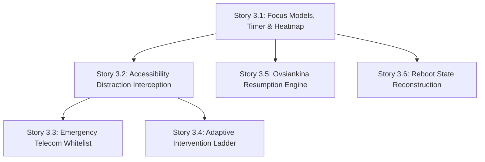

# Epic 3 Context: Focus Mode, Distraction Interception & Resumption Engine

<!-- Compiled from planning artifacts. Aligned with ARCHITECTURE-SPINE.md (AD-1 to AD-8) and project-context.md. -->

## Goal

Users can initiate focused work and study sessions with distraction interception and intervention on supported Android devices via an opt-in event-driven `AccessibilityService`, experience gentle single-prompt JITAI nudges during scheduled blocks, navigate a deliberate override friction ladder when attempting to open blocked apps, enjoy automatic immunity for telecom and emergency calls, and resume interrupted sessions seamlessly from the Hero Card without guilt or data loss (Ovsiankina effect).

## Stories

- Story 3.1: Focus & Study Session Models, Timer & Heatmap Tracking
- Story 3.2: Event-Driven Accessibility Distraction Interception & Privacy Invariant
- Story 3.3: Emergency & Telecom Dynamic Whitelist Bypass
- Story 3.4: Adaptive Intervention Ladder, JITAI Restraint & Override Friction
- Story 3.5: Ovsiankina Resumption Engine & Hero Resumption Card
- Story 3.6: OS Process Termination & Reboot State Reconstruction

## Requirements & Constraints

- **Foreground Focus Service:** Continuous timer tracking with foreground service notification keeping session state alive in background.
- **Heatmap Aggregation:** Track study and focus duration aggregated daily into a subject study contribution heatmap ledger (FR-4.2).
- **Valid Session & Coin Allocation:** Sessions meeting a validity threshold (>= 10 minutes) qualify for Coin reward allocation into the idempotent economy ledger (FR-2.5, FR-8.2).
- **Hero State Priority 1:** An active focus session transforms the Hero Card into Priority 1 (`ActiveFocus`) state with live countdown/count-up timer in `{typography.data-large}`.
- **Non-Punishing Design (AD-4):** Interrupted sessions transition gracefully to `INTERRUPTED/RESUMABLE` with zero shaming copy, zero streak resets, and 1-tap resumption actions.
- **Strict Domain Purity (AD-1):** Interval models, duration calculations, and heatmap aggregation engines reside purely in `domain/` with zero Android framework imports.
- **Design Tokens (AD-7):** Warm Organic Tactile design tokens strictly enforced for timer ring dial, progress arc (`#F26B1D`), background canvas (`#F9F6F0`), and heatmap contribution grid.

## Technical Decisions

- **Domain Models & Engines:**
  - `StudySession.kt` & focus interval domain models (Deep Work, Pomodoro Work, Pomodoro Break, Review).
  - `HeatmapLedgerEngine.kt`: Aggregates focus minutes by date and subject into heatmap cells with intensity levels (0 to 4).
  - `FocusRescheduleEngine.kt`: Manages timeline recalculations and schedule shifts for focus extensions or pauses.
- **Persistence:**
  - `StudySessionEntity` and `FocusSessionEntity` in Room over SQLCipher with Flow-based SSOT queries in `StudySessionRepository`.
- **Platform Runtime Services:**
  - `StudySessionForegroundService.kt`: Platform foreground service broadcasting timer countdown ticks and managing pause/resume/stop lifecycle.
- **UI Architecture (AD-2):**
  - MVI pattern on `StudyViewModel`: single `StudyUiState`, `StudyUiIntent`, and `StudyUiEffect`.
  - `StudyScreen.kt`: Circular countdown progress arc, focus tag selector, interval mode pills, and subject heatmap contribution graph.

## UX & Interaction Patterns

- **Timer Display:** Circular ring dial with sand track (`#EBE5DC`), Vibrant Tangerine progress arc (`#F26B1D`), and bold data-large countdown digits (`#59280E`).
- **Tag Selector:** Full-pill tactile subject tags with pastel icon containers (`#FCD9B8`, `#A3D929`, `#FFE8D6`).
- **Subject Study Heatmap:** 7-column or multi-week contribution grid rendering daily focus intensity from sand subtle (0) to matcha/tangerine saturated (4).
- **Hero Action Card:** Dynamically transitions to Priority 1 `ActiveFocus` when timer is active, providing persistent control across the entire app.

## Cross-Story Dependencies

