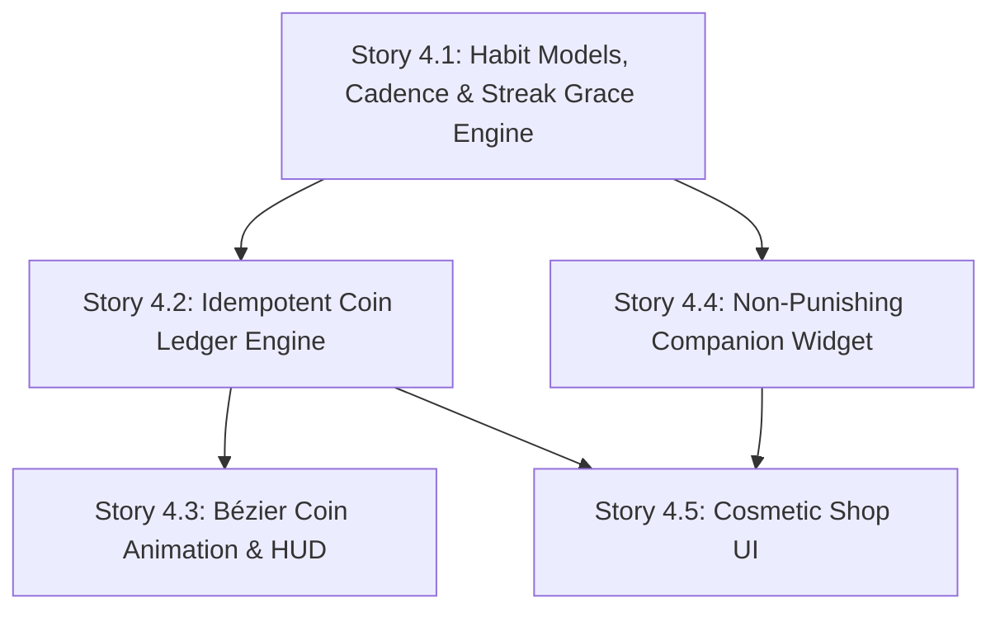

# Epic 4 Context: Habits, Non-Punishing Companion & Coins Economy

<!-- Compiled from planning artifacts. Aligned with ARCHITECTURE-SPINE.md (AD-1 to AD-8) and project-context.md. -->

## Goal

Users can track sustainable habits with miss-tolerant streak slack and freeze days, watch a non-punishing virtual companion pet celebrate their accomplishments on the Hero Card (with zero guilt, HP loss, or character death), earn Coins into an idempotent ledger from genuine completions across all domain items, and spend earned Coins in a local cosmetic shop on companion outfits, accessories, and room decor.

## Stories

- Story 4.1: Habit Entity Models, Cadence Tracking & Streak Grace Engine
- Story 4.2: Idempotent Coin Ledger Engine & Anti-Farming Model
- Story 4.3: VSYNC-Aligned Bézier Coin Earn Animation & Coin HUD
- Story 4.4: Non-Punishing Companion Widget & 7-State Rive Machine
- Story 4.5: Cosmetic Shop UI & Companion Customization

## Requirements & Constraints

- **Non-Punitive Habit & Streak Tracking (FR-2.4, AD-4):**
  - Habits support flexible cadences: Daily, Specific Days of Week (1..7 matching `M T W T F S S`), and Weekly Target Frequency.
  - Off-cadence days are immune: unscheduled days never penalize active streaks or consume freeze/slack reserves.
  - Active `DayType` immunity: days marked as `LOW_CAPACITY` or `REST_RECOVERY` automatically freeze habit requirements without consuming slack bank days or resetting streaks.
  - Missed cadence days absorb earned streak slack or active freeze shields before resetting streaks.
  - Zero shame, nag, or guilt copy across all UI microcopy, dialogs, and notifications.
- **Auditable Idempotent Economy (FR-8.2, FR-8.3, ARCH-6, AD-3):**
  - Genuine completion events across all domains (Tasks, Habits, Routines, Study Sessions) earn Coins into an append-only `CoinLedgerEntity`.
  - Deterministic compound idempotency keys (`HABIT_LOG_{habitId}_{date}`) backed by database unique constraints guarantee atomic single-award execution.
  - Coins cannot purchase streak freezes in v1 (FR-8.5); streak slack is earned strictly through real consistency milestones.
- **Warm Organic Tactile Presentation (AD-7):**
  - Visual indicators: 4-state flame model (`COLD`, `WARMING`, `BURNING`, `BLAZING`) plus `GRACE_SHIELD` protection status.
  - Habit completion percentages and weekly insights mapped to `VerticalCapsuleBars` with Warm Organic Tactile design tokens.
  - Minimum touch target floor of 48dp on all interactive elements.
- **Strict Architectural Boundaries (AD-1, AD-2):**
  - Domain models and streak state evaluation engines remain 100% pure Kotlin with zero `android.*` or `androidx.*` dependencies.
  - Screens follow Unidirectional MVI: single `UiState`, single `UiIntent`, and Channel-backed `UiEffect`.

## Technical Decisions

- **Domain Layer (`domain/`):**
  - `Habit.kt`: Core domain model expanded with cadence schedule definitions (`CadenceType`, `HabitCadence`), reminder configuration, and target frequencies.
  - `HabitCadence.kt`: Pure Kotlin cadence representations (`Daily`, `SpecificDays`, `WeeklyFrequency`) with evaluation helpers.
  - `StreakStateMachine.kt`: Pure Kotlin state machine managing deterministic transitions, slack banking (`MAX_SLACK_BANK_DAYS = 3`, `SLACK_EARN_CADENCE_DAYS = 7`), freeze shields, off-cadence day immunity, and `DayType` immunity.
  - `EvaluateHabitStreaksUseCase.kt`: Daily evaluation usecase checking uncompleted habits, applying grace shields/slack, and recording non-punitive audit logs.
  - `LogHabitUseCase.kt`: Idempotent completion logger updating streak state, recording `HabitLog`, and awarding coins.
- **Persistence Layer (`data/`):**
  - `HabitEntity.kt` & `HabitLogEntity.kt`: Room entities with Room migration `MIGRATION_2_3` adding cadence and goal target columns.
  - `HabitDao.kt` & `HabitRepositoryImpl.kt`: Flow-based SSOT queries and transactional log-with-reward operations.
- **Presentation Layer (`ui/`):**
  - `HabitsViewModel.kt`: MVI ViewModel exposing `HabitsUiState` with live completion calculations, active streak counts, and flame states.
  - `HabitStreakCard.kt`: Tactile card rendering habit details, 7-day cadence strip, streak flame badge, freeze shield badge, and 48dp checkbox.
  - `VerticalCapsuleBars.kt`: Dynamic 4-capsule progress bar rendering weekly habit completion percentages with token colors.

## UX & Interaction Patterns

- **Streak Visual Progression:**
  - `COLD`: 0 days (Muted Cool Slate)
  - `WARMING`: 1–2 days (Yellow-Orange Flame Tip)
  - `BURNING`: 3–6 days (Vibrant Orange Flame Core)
  - `BLAZING`: 7+ days (Full Orange Flame Core)
  - `GRACE_SHIELD`: Active freeze or slack-absorbed day (Info Blue / Shield Indicator)
- **Non-Punitive Recovery:**
  - Missing a scheduled day displays reassuring copy: "Streak protected by Grace Shield" or "Rest day preserved".
  - Best streak is never reset or decremented.

## Cross-Story Dependencies

