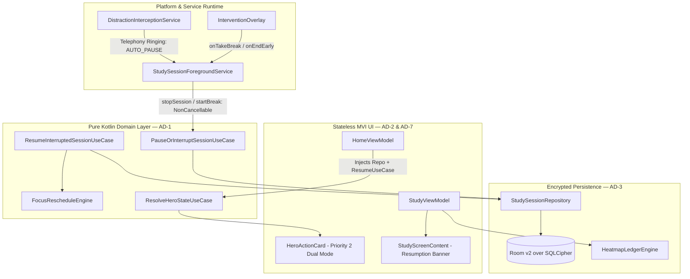

# Technical Specification: Story 3.4 — Frictionless Interruption Handling & Zero-Guilt Resumption

<!-- Aligned with ARCHITECTURE-SPINE.md (AD-1 to AD-8), OKF v0.2, and Elephant-Goldfish Model (EGM) Design Rules -->
<!-- Revised based on EGM Pre-Code Review Gate: Findings B-1..B-3, M-1..M-6, N-1..N-3 -->

| Metadata | Value |
| :--- | :--- |
| **Story ID** | `3-4-frictionless-interruption-handling-zero-guilt-resumption` |
| **Epic ID** | `epic-3` (Focus Mode, Distraction Interception & Resumption Engine) — Final Story |
| **Document State** | Approved / Implementation-Ready (Post-EGM Gate Revisions) |
| **Author** | The Elephant (Synthesized from Goldfish Swarm Review) |
| **Target Codebase** | `app/src/main/java/com/personaltracker/` |
| **Design Invariants** | Strict "No Code During Design" • AD-1 Domain Purity • AD-2 MVI • AD-3 Offline Persistence • AD-4 Zero-Guilt Copy • AD-7 Design Tokens • AD-8 Distraction Privacy |

---

## 1. Executive Summary & Problem Space

### 1.1 The Ovsiankina Effect & Cognitive Friction in Habit Preservation
When users are unexpectedly interrupted during an active focus block (e.g., incoming phone call, urgent task interruption, or opening a necessary communication tool), conventional productivity apps discard uncompleted sessions or reset streak counters. Under the **Ovsiankina effect** (EXP-032), an interrupted task creates continuous psychological tension that can be channeled productively *if and only if* the system preserves all invested progress and provides an effortless, one-tap resumption path.

### 1.2 Core Objectives of Story 3.4
1. **Instant Partial Focus Banking (AD-3, AD-4):** Every second and minute invested in an active focus session is immediately credited into `StudySessionRepository` upon interruption (`isInterrupted = true`, `actualElapsedMinutes > 0`) using `NonCancellable` persistence on service shutdown, and reflected in `HeatmapLedgerEngine` without punitive streak resets.
2. **Three-Action Intervention Overlay Wiring (AD-8):** Fully wire the three actions on `InterventionCard` within `InterventionOverlay` ("Resume Focus", "Take a 5m Break", "End Early") so tapping them in the system alert window executes atomic service state transitions (`ACTION_START_BREAK`, `ACTION_STOP`, `ACTION_RESUME`) and cleanly dismisses the overlay window.
3. **Telephony & Real-World Interruption Immunity:** Incoming and active phone calls (`CALL_STATE_RINGING`, `CALL_STATE_OFFHOOK`) detected by `DistractionInterceptionService` automatically dismiss active overlays, gracefully pause the focus session per `activeFocusTimerPolicy`, and leave the session in a frictionless paused state. Upon call end (`CALL_STATE_IDLE`), the session intentionally remains paused per AD-4 until the user manually resumes.
4. **Hero Card & Study Screen Zero-Guilt Resumption UI (AD-2, AD-7):** Surface interrupted focus blocks on both `HeroActionCard` (Priority 2: `InterruptedResumable`) and `StudyScreenContent` with supportive, encouraging zero-guilt microcopy (e.g., *"Pick back up where you left off — 18 min banked!"*) using 100% `PersonalTrackerTheme` semantic tokens (0 raw hex/dp literals, 48dp touch target floor, AD-7), with dual-mode support preserving task completion/review actions.

---

## 2. Architectural Invariants & Non-Negotiables

| Invariant | Architectural Enforcement |
| :--- | :--- |
| **AD-1: Domain Purity** | `PauseOrInterruptSessionUseCase.kt`, `ResumeInterruptedSessionUseCase.kt`, and `FocusRescheduleEngine.kt` reside strictly in `com.personaltracker.domain`. Zero imports of `android.*` or `androidx.*`. `FocusRescheduleEngine` provides `@Inject constructor()`. |
| **AD-2: Unidirectional MVI Contract** | `HomeViewModel` and `StudyViewModel` expose immutable `StateFlow<UiState>`, handle sealed `UiIntent`s, and dispatch one-off side effects via `Channel<UiEffect>`. Handles both State A (in-memory live-pause) and State B (cold-start from Room) resumption cleanly. |
| **AD-3: Offline Encrypted Persistence** | All session updates execute in Room `@Transaction` blocks on `Dispatchers.IO` via `StudySessionRepositoryImpl` over SQLCipher. Room database bumped from v1 to v2 with `MIGRATION_1_2` adding `targetDurationMinutes`, `actualElapsedMinutes`, and `intervalType` to `study_sessions`. Service shutdown wraps writes in `NonCancellable` to prevent aborts during `serviceScope.cancel()`. |
| **AD-4: Non-Punishing Psychological Invariant** | Interrupted sessions never trigger streak breaks, shame copy, or coin clawbacks. Microcopy emphasizes banked progress (*"X min banked!"*) and calm readiness (*"Ready whenever you are"*). |
| **AD-7: Strict Design Token Conformance** | Zero hardcoded hex colors, zero raw `dp`/`sp` literals in `HeroActionCard` and `StudyScreen`. All dimensions and colors resolved via `PersonalTrackerTheme.colors`, `PersonalTrackerTheme.spacing`, `PersonalTrackerTheme.typography`, and `PersonalTrackerTheme.shapes`. Minimum touch target floor of 48dp (`spacing.minTouchTarget`). |
| **AD-8: Privacy Invariant in Accessibility** | `DistractionInterceptionService` monitors only `AccessibilityEvent.TYPE_WINDOW_STATE_CHANGED`, extracting solely the target package name with `canRetrieveWindowContent = false`. Dismissal and banking are event-driven with zero screen content inspection. |

---

## 3. Domain Engine & Interactors (Pure Kotlin — AD-1)



### 3.1 `FocusRescheduleEngine.kt` Enhancements
Add `@Inject constructor()`, `InterruptionReason`, and non-punitive prompt formatters to `FocusRescheduleEngine.kt`:

```kotlin
package com.personaltracker.domain.engine

import com.personaltracker.domain.model.FocusIntervalType
import java.time.LocalTime
import java.time.format.DateTimeFormatter
import javax.inject.Inject

/**
 * Pure Kotlin behavioral engine managing study session pause/resume recalculation,
 * break overrun adjustments, Pomodoro cycle progression, and non-punitive schedule shifting (FR-4.1, FR-4.5, AD-1, AD-3).
 */
class FocusRescheduleEngine @Inject constructor() {

    enum class InterruptionReason {
        PHONE_CALL,
        USER_PAUSE,
        USER_BREAK,
        DISTRACTION_OVERLAY_BREAK,
        USER_END_EARLY,
        TASK_OVERRIDE,
        APP_BACKGROUNDED
    }

    data class InterruptionSummary(
        val plannedDurationMinutes: Int,
        val elapsedMinutes: Int,
        val remainingMinutes: Int,
        val advisoryMessage: String
    )

    data class ResumptionPlan(
        val sessionId: String,
        val subjectTag: String,
        val targetDurationMinutes: Int,
        val bankedMinutes: Int,
        val remainingDurationMinutes: Int,
        val intervalType: FocusIntervalType,
        val advisoryMessage: String
    )

    fun calculateInterruptionSummary(
        plannedDurationMinutes: Int,
        elapsedSeconds: Long,
        reason: InterruptionReason = InterruptionReason.USER_PAUSE
    ): InterruptionSummary {
        val elapsedMinutes = (elapsedSeconds / 60).toInt().coerceAtLeast(0)
        val remainingMinutes = maxOf(0, plannedDurationMinutes - elapsedMinutes)
        val advisory = when (reason) {
            InterruptionReason.PHONE_CALL ->
                "Call handled. $elapsedMinutes min banked — ready to jump back in whenever you are."
            InterruptionReason.DISTRACTION_OVERLAY_BREAK,
            InterruptionReason.USER_BREAK ->
                "Resting for 5 min. $elapsedMinutes min banked from your session."
            InterruptionReason.USER_END_EARLY ->
                "Session ended calmly. $elapsedMinutes min banked for today."
            else ->
                if (elapsedMinutes > 0) {
                    "Focus block paused with $remainingMinutes min remaining. $elapsedMinutes min banked!"
                } else {
                    "Focus block paused. Ready to jump back in whenever you are."
                }
        }
        return InterruptionSummary(
            plannedDurationMinutes = plannedDurationMinutes,
            elapsedMinutes = elapsedMinutes,
            remainingMinutes = remainingMinutes,
            advisoryMessage = advisory
        )
    }

    fun formatResumptionPrompt(bankedMinutes: Int, remainingMinutes: Int): String {
        return if (bankedMinutes > 0) {
            "Pick back up where you left off — $bankedMinutes min banked!"
        } else {
            "Ready to jump back in whenever you are."
        }
    }
}
```

---

### 3.2 `PauseOrInterruptSessionUseCase.kt` (New File)
- **Package:** `com.personaltracker.domain.usecase`
- **Dependencies:** `@Inject constructor(private val studySessionRepository: StudySessionRepository, private val focusRescheduleEngine: FocusRescheduleEngine)`
- **Signature & Logic:**
```kotlin
package com.personaltracker.domain.usecase

import com.personaltracker.domain.engine.FocusRescheduleEngine
import com.personaltracker.domain.engine.FocusRescheduleEngine.InterruptionReason
import com.personaltracker.domain.model.FocusIntervalType
import com.personaltracker.domain.model.StudySession
import com.personaltracker.domain.repository.StudySessionRepository
import java.time.LocalDate
import java.time.LocalTime
import java.time.format.DateTimeFormatter
import javax.inject.Inject

data class PauseOrInterruptResult(
    val sessionId: String,
    val bankedMinutes: Int,
    val remainingMinutes: Int,
    val isInterrupted: Boolean,
    val advisoryMessage: String
)

class PauseOrInterruptSessionUseCase @Inject constructor(
    private val studySessionRepository: StudySessionRepository,
    private val focusRescheduleEngine: FocusRescheduleEngine
) {
    suspend operator fun invoke(
        sessionId: String,
        elapsedSeconds: Long,
        totalSeconds: Long,
        subjectTag: String = "Focus",
        intervalType: FocusIntervalType = FocusIntervalType.DEEP_WORK,
        reason: InterruptionReason = InterruptionReason.USER_PAUSE
    ): PauseOrInterruptResult {
        val totalMinutes = (totalSeconds / 60).toInt().coerceAtLeast(1)
        val summary = focusRescheduleEngine.calculateInterruptionSummary(
            plannedDurationMinutes = totalMinutes,
            elapsedSeconds = elapsedSeconds,
            reason = reason
        )

        val today = LocalDate.now().toString()
        val timeNow = LocalTime.now().format(DateTimeFormatter.ofPattern("HH:mm"))

        val session = StudySession(
            id = sessionId,
            subjectTag = subjectTag,
            sessionDate = today,
            startTime = timeNow,
            durationMinutes = summary.elapsedMinutes,
            coinsEarned = 0,
            linkedTaskId = null,
            isInterrupted = true,
            targetDurationMinutes = totalMinutes,
            actualElapsedMinutes = summary.elapsedMinutes,
            intervalType = intervalType
        )

        studySessionRepository.saveSession(session)

        return PauseOrInterruptResult(
            sessionId = sessionId,
            bankedMinutes = summary.elapsedMinutes,
            remainingMinutes = summary.remainingMinutes,
            isInterrupted = true,
            advisoryMessage = summary.advisoryMessage
        )
    }
}
```

---

### 3.3 `ResumeInterruptedSessionUseCase.kt` (New File)
- **Package:** `com.personaltracker.domain.usecase`
- **Dependencies:** `@Inject constructor(private val studySessionRepository: StudySessionRepository, private val focusRescheduleEngine: FocusRescheduleEngine)`
- **Signature & Logic:**
```kotlin
package com.personaltracker.domain.usecase

import com.personaltracker.domain.engine.FocusRescheduleEngine
import com.personaltracker.domain.engine.FocusRescheduleEngine.ResumptionPlan
import com.personaltracker.domain.repository.StudySessionRepository
import kotlinx.coroutines.flow.first
import javax.inject.Inject

class ResumeInterruptedSessionUseCase @Inject constructor(
    private val studySessionRepository: StudySessionRepository,
    private val focusRescheduleEngine: FocusRescheduleEngine
) {
    suspend operator fun invoke(
        sessionId: String? = null,
        fallbackSubjectTag: String = "Focus",
        fallbackDurationMinutes: Int = 25
    ): ResumptionPlan? {
        val sessions = studySessionRepository.getAllSessions().first()

        val session = if (sessionId != null) {
            sessions.find { it.id == sessionId && it.isInterrupted }
        } else {
            // Find most recent interrupted non-break session that has remaining focus time (prevents zombie loops)
            sessions.firstOrNull {
                it.isInterrupted && !it.isBreak && it.actualElapsedMinutes < it.targetDurationMinutes
            }
        } ?: return null

        val banked = if (session.actualElapsedMinutes > 0) session.actualElapsedMinutes else session.durationMinutes
        val target = if (session.targetDurationMinutes > 0) session.targetDurationMinutes else fallbackDurationMinutes
        val remaining = maxOf(1, target - banked)

        return ResumptionPlan(
            sessionId = session.id,
            subjectTag = session.subjectTag,
            targetDurationMinutes = target,
            bankedMinutes = banked,
            remainingDurationMinutes = remaining,
            intervalType = session.intervalType,
            advisoryMessage = focusRescheduleEngine.formatResumptionPrompt(bankedMinutes = banked, remainingMinutes = remaining)
        )
    }
}
```

---

### 3.4 `ResolveHeroStateUseCase.kt` Priority 2 Refinement
Update `HeroActiveSession`:
```kotlin
data class HeroActiveSession(
    val sessionId: String? = null,
    val subjectTag: String,
    val totalSeconds: Long = 0L,
    val remainingSeconds: Long = 0L,
    val formattedRemainingTime: String = "00:00",
    val isRunning: Boolean = false,
    val isPaused: Boolean = false,
    val isCompleted: Boolean = false,
    val bankedMinutes: Int = 0
)
```

Update `HeroPriorityState.InterruptedResumable`:
```kotlin
data class InterruptedResumable(
    val taskId: String? = null,
    val sessionId: String? = null,
    val title: String,
    val elapsedSinceFormatted: String = "Paused",
    val bankedMinutes: Int = 0,
    val remainingMinutes: Int = 0,
    val advisoryPrompt: String = "Pick back up where you left off",
    val isStudySession: Boolean = false
) : HeroPriorityState {
    override val priority: Int = 2
}
```

Update `ResolveHeroStateUseCase.resolve()` and `invoke()`:
```kotlin
fun resolve(
    activeSession: HeroActiveSession? = null,
    interruptedSession: StudySession? = null,
    interruptedTask: Task? = null,
    isMorningBannerDismissed: Boolean = false,
    activeDayTypeName: String = "Standard Routine",
    activeDayTypeId: String? = null,
    pendingTasks: List<Task> = emptyList(),
    overdueTasks: List<Task> = emptyList(),
    snoozedTaskIds: Set<String> = emptySet(),
    activeRoutineStep: RoutineStep? = null,
    isRoutineStepCompleted: Boolean = false
): HeroPriorityState {
    // Priority 1: ActiveFocus
    if (activeSession != null && activeSession.isRunning && !activeSession.isCompleted) {
        return HeroPriorityState.ActiveFocus(activeSession)
    }

    // Priority 2: InterruptedResumable
    // 2A: Live in-memory paused timer session (State A)
    if (activeSession != null && activeSession.isPaused && !activeSession.isCompleted) {
        val remainingMin = (activeSession.remainingSeconds / 60).toInt()
        return HeroPriorityState.InterruptedResumable(
            sessionId = activeSession.sessionId,
            title = "${activeSession.subjectTag} Session",
            elapsedSinceFormatted = "Paused",
            bankedMinutes = activeSession.bankedMinutes,
            remainingMinutes = remainingMin,
            advisoryPrompt = if (activeSession.bankedMinutes > 0)
                "Pick back up where you left off — ${activeSession.bankedMinutes} min banked!"
            else
                "Ready to jump back in whenever you are.",
            isStudySession = true
        )
    }

    // 2B: Interrupted study session from Room (State B)
    if (interruptedSession != null && interruptedSession.isInterrupted &&
        interruptedSession.actualElapsedMinutes < interruptedSession.targetDurationMinutes
    ) {
        val banked = interruptedSession.actualElapsedMinutes
        val remaining = maxOf(1, interruptedSession.targetDurationMinutes - banked)
        return HeroPriorityState.InterruptedResumable(
            sessionId = interruptedSession.id,
            title = "${interruptedSession.subjectTag} Session",
            elapsedSinceFormatted = "$banked min banked",
            bankedMinutes = banked,
            remainingMinutes = remaining,
            advisoryPrompt = "Pick back up where you left off — $banked min banked!",
            isStudySession = true
        )
    }

    // 2C: Interrupted Task
    if (interruptedTask != null && interruptedTask.state.equals("INTERRUPTED", ignoreCase = true)) {
        return HeroPriorityState.InterruptedResumable(
            taskId = interruptedTask.id,
            title = interruptedTask.title,
            elapsedSinceFormatted = "Paused",
            isStudySession = false
        )
    }

    // Priority 3..6: MorningBanner, UpcomingItem, CarryForwardReview, IntentionalIdle (unchanged)
    ...
}
```

---

## 4. Encrypted Persistence & Schema Migration (AD-3)

### 4.1 `StudySessionEntity.kt` & Room Migration 1 -> 2
Add `targetDurationMinutes`, `actualElapsedMinutes`, and `intervalType` to `StudySessionEntity`:
```kotlin
package com.personaltracker.data.local.db.entities

import androidx.room.Entity
import androidx.room.Index
import androidx.room.PrimaryKey

@Entity(
    tableName = "study_sessions",
    indices = [
        Index("subjectTag"),
        Index("sessionDate")
    ]
)
data class StudySessionEntity(
    @PrimaryKey val id: String, // UUIDv4
    val subjectTag: String,
    val sessionDate: String, // "YYYY-MM-DD"
    val startTime: String, // "HH:mm"
    val durationMinutes: Int,
    val coinsEarned: Int,
    val linkedTaskId: String?,
    val isInterrupted: Boolean,
    val createdTimestamp: Long,
    val targetDurationMinutes: Int = durationMinutes,
    val actualElapsedMinutes: Int = durationMinutes,
    val intervalType: String = "DEEP_WORK"
)
```

In `AppDatabase.kt`:
- Bump `@Database(version = 2)`
- Add `MIGRATION_1_2`:
```kotlin
val MIGRATION_1_2 = object : Migration(1, 2) {
    override fun migrate(db: SupportSQLiteDatabase) {
        db.execSQL("ALTER TABLE study_sessions ADD COLUMN targetDurationMinutes INTEGER NOT NULL DEFAULT 0")
        db.execSQL("ALTER TABLE study_sessions ADD COLUMN actualElapsedMinutes INTEGER NOT NULL DEFAULT 0")
        db.execSQL("ALTER TABLE study_sessions ADD COLUMN intervalType TEXT NOT NULL DEFAULT 'DEEP_WORK'")
    }
}
```
In `DatabaseModule.kt`:
- Chain `.addMigrations(AppDatabase.MIGRATION_1_2)` on `Room.databaseBuilder`.

In `DataMappers.kt`:
- Update `toDomain()` and `toEntity()` to map `targetDurationMinutes`, `actualElapsedMinutes`, and `intervalType = FocusIntervalType.valueOf(intervalType)`.

---

## 5. Platform Runtime Services & Overlay Wiring

### 5.1 `StudySessionForegroundService.kt`
1. **Inject `PauseOrInterruptSessionUseCase`:**
   ```kotlin
   @Inject
   lateinit var pauseOrInterruptSessionUseCase: PauseOrInterruptSessionUseCase
   ```
2. **Intent Actions:**
   ```kotlin
   const val ACTION_START = "com.personaltracker.action.START_STUDY_SESSION"
   const val ACTION_PAUSE = "com.personaltracker.action.PAUSE_STUDY_SESSION"
   const val ACTION_RESUME = "com.personaltracker.action.RESUME_STUDY_SESSION"
   const val ACTION_STOP = "com.personaltracker.action.STOP_STUDY_SESSION"
   const val ACTION_START_BREAK = "com.personaltracker.action.START_BREAK"
   const val EXTRA_BREAK_MINUTES = "extra_break_minutes"
   ```
3. **`stopSession` with `NonCancellable` (Finding B-1):**
   ```kotlin
   private fun stopSession(interrupted: Boolean) {
       val currentState = _timerState.value
       val sessionId = currentState.sessionId

       timer?.stop()

       val prefs = getSharedPreferences(PREFS_NAME, Context.MODE_PRIVATE)
       prefs.edit().remove(KEY_ACTIVE_SESSION_ID).apply()

       if (interrupted && sessionId != null) {
           serviceScope.launch(Dispatchers.IO + NonCancellable) {
               runCatching {
                   val elapsedSeconds = currentState.totalSeconds - currentState.remainingSeconds
                   pauseOrInterruptSessionUseCase(
                       sessionId = sessionId,
                       elapsedSeconds = elapsedSeconds,
                       totalSeconds = currentState.totalSeconds,
                       subjectTag = currentState.subjectTag,
                       intervalType = currentState.intervalType,
                       reason = InterruptionReason.USER_END_EARLY
                   )
               }
           }
       }

       stopForeground(STOP_FOREGROUND_REMOVE)
       stopSelf()
   }
   ```
4. **Atomic `ACTION_START_BREAK` Handling (Finding B-2):**
   ```kotlin
   private fun handleStartBreak(breakMinutes: Int = 5) {
       val currentState = _timerState.value
       val activeSessionId = currentState.sessionId

       timer?.stop()

       if (activeSessionId != null && currentState.intervalType != FocusIntervalType.SHORT_BREAK) {
           serviceScope.launch(Dispatchers.IO + NonCancellable) {
               val elapsedSeconds = currentState.totalSeconds - currentState.remainingSeconds
               pauseOrInterruptSessionUseCase(
                   sessionId = activeSessionId,
                   elapsedSeconds = elapsedSeconds,
                   totalSeconds = currentState.totalSeconds,
                   subjectTag = currentState.subjectTag,
                   intervalType = currentState.intervalType,
                   reason = InterruptionReason.DISTRACTION_OVERLAY_BREAK
               )
           }
       }

       val breakDurationSeconds = breakMinutes * 60L
       val breakSessionId = UUID.randomUUID().toString()
       startSession(
           sessionId = breakSessionId,
           subjectTag = "Break",
           durationSeconds = breakDurationSeconds,
           intervalType = FocusIntervalType.SHORT_BREAK
       )
   }
   ```
5. **Update `timerState` with `bankedMinutes`:**
   In `StudySessionTimerState`:
   ```kotlin
   data class StudySessionTimerState(
       val sessionId: String? = null,
       val subjectTag: String = "Focus",
       val totalSeconds: Long = 0L,
       val remainingSeconds: Long = 0L,
       val isRunning: Boolean = false,
       val isPaused: Boolean = false,
       val isCompleted: Boolean = false,
       val intervalType: FocusIntervalType = FocusIntervalType.DEEP_WORK,
       val bankedMinutes: Int = ((totalSeconds - remainingSeconds) / 60).toInt().coerceAtLeast(0)
   )
   ```

### 5.2 `InterventionOverlay.kt` Wiring
Wire all 3 `InterventionCard` actions directly to atomic service commands:
```kotlin
InterventionCard(
    onResumeFocus = {
        dismiss()
        StudySessionForegroundService.resumeService(context)
        launchMainActivity()
    },
    onTakeBreak = {
        dismiss()
        StudySessionForegroundService.startBreakService(context, breakMinutes = 5)
        launchMainActivity()
    },
    onEndEarly = {
        dismiss()
        StudySessionForegroundService.stopService(context)
    },
    appDisplayName = appDisplayName
)
```

### 5.3 `DistractionInterceptionService.kt`
- On `CALL_STATE_RINGING` or `CALL_STATE_OFFHOOK`:
  1. `interventionOverlay?.dismiss()` (EXP-035).
  2. If `activeFocusTimerPolicy == AUTO_PAUSE`: `StudySessionForegroundService.pauseService(this)`.
- On `CALL_STATE_IDLE`:
  - `isCallActive = false`. Timer intentionally remains paused per AD-4; user explicitly resumes.

---

## 6. Presentation Layer & Warm Organic Tactile UI (AD-2, AD-7)

### 6.1 `HeroActionCard.kt` Presentation
- `HeroCardState.InterruptedResumable` (Dual-Mode):
```kotlin
data class InterruptedResumable(
    val title: String,
    val elapsedSinceFormatted: String,
    val bankedMinutes: Int = 0,
    val remainingMinutes: Int = 0,
    val advisoryPrompt: String = "Pick back up where you left off",
    val isStudySession: Boolean = false,
    val onResume: () -> Unit = {},
    val onTakeBreak: () -> Unit = {},
    val onEndEarly: () -> Unit = {},
    val onReview: () -> Unit = {},
    val onMarkComplete: () -> Unit = {}
) : HeroCardState {
    override val priority: Int = 2
}
```
- In `InterruptedResumableContent`:
  - Badge: `Text("PAUSED • RESUMABLE", style = typography.caption, color = colors.warning)`
  - Title: `Text(state.title, style = typography.title, color = colors.inkPrimary)`
  - Subtitle: `Text(state.advisoryPrompt, style = typography.bodySecondary, color = colors.inkSecondary)`
  - If `state.isStudySession`:
    - Row of buttons:
      - `Button(onClick = state.onResume, colors = ButtonDefaults.buttonColors(containerColor = colors.primary), modifier = Modifier.weight(1.2f).defaultMinSize(minHeight = spacing.minTouchTarget))`: Text `"Resume (${state.remainingMinutes}m)"`
      - `OutlinedButton(onClick = state.onTakeBreak, modifier = Modifier.weight(1f).defaultMinSize(minHeight = spacing.minTouchTarget))`: Text `"5m Break"`
      - `TextButton(onClick = state.onEndEarly, modifier = Modifier.weight(1f).defaultMinSize(minHeight = spacing.minTouchTarget))`: Text `"End Early"`
  - Else (Task):
    - Row with Resume, Review, Complete buttons (preserved 100% for backwards compatibility).

### 6.2 `HomeViewModel.kt` Wiring
1. Inject:
   ```kotlin
   private val studySessionRepository: StudySessionRepository,
   private val resumeInterruptedSessionUseCase: ResumeInterruptedSessionUseCase,
   ```
2. In `observeDataStreams()`:
   Observe `studySessionRepository.getAllSessions()` in `baseDataFlow` to find:
   ```kotlin
   val latestInterruptedStudySession = sessions.firstOrNull {
       it.isInterrupted && !it.isBreak && it.actualElapsedMinutes < it.targetDurationMinutes
   }
   ```
   Pass `interruptedSession = latestInterruptedStudySession` into `resolveHeroStateUseCase.resolve(...)`.
3. Map to `HeroCardState.InterruptedResumable`:
   ```kotlin
   onResume = {
       if (resolvedHeroPriority.isStudySession) {
           handleResumeStudySession(resolvedHeroPriority.sessionId)
       } else if (resolvedHeroPriority.taskId != null) {
           onIntent(HomeUiIntent.ResumeInterruptedTask(resolvedHeroPriority.taskId))
       }
   },
   onTakeBreak = {
       context?.let { ctx -> StudySessionForegroundService.startBreakService(ctx, 5) }
   },
   onEndEarly = {
       context?.let { ctx -> StudySessionForegroundService.stopService(ctx) }
   }
   ```
4. `handleResumeStudySession`:
   - If `StudySessionForegroundService.timerState.value.isPaused` (State A): `StudySessionForegroundService.resumeService(ctx)`.
   - Else (State B): Launch coroutine to get `plan = resumeInterruptedSessionUseCase(sessionId)` and start `StudySessionForegroundService.startService(ctx, plan.sessionId, plan.subjectTag, plan.remainingDurationMinutes * 60L, plan.intervalType)`.

### 6.3 `StudyViewModel.kt` & `StudyScreenContent`
1. **Fix `todayMinutes` Calculation in `observeSessionsJob`:**
   ```kotlin
   val todayMinutes = sessions
       .filter { it.sessionDate == today && !it.isBreak }
       .sumOf { if (it.actualElapsedMinutes > 0) it.actualElapsedMinutes else it.durationMinutes }
   ```
2. **Support `StudyUiIntent.TakeFiveMinuteBreak`:**
   ```kotlin
   is StudyUiIntent.TakeFiveMinuteBreak -> {
       val ctx = context ?: return
       StudySessionForegroundService.startBreakService(ctx, intent.breakMinutes)
   }
   ```
3. **Resumption Banner in `StudyScreenContent`:**
   When `timer.isPaused` or `(!timer.isRunning && state.interruptedSession != null)`:
   Display Warm Organic Tactile Resumption Card above the dial:
   - Container: `Surface(shape = shapes.xxl, color = colors.bannerPeach, border = BorderStroke(spacing.spacing0_5, colors.borderSubtle))`
   - Copy: `"Pick back up where you left off — ${bankedMinutes} min banked!"`
   - Actions: Resume (`colors.primary`), 5m Break (`colors.iconSoftMatcha` / outlined), End Early.
   - All touch targets >= 48dp floor (`spacing.minTouchTarget`).

---

## 7. Implementation File Map

| Component | Path | Action |
| :--- | :--- | :--- |
| **Domain Engine** | `domain/engine/FocusRescheduleEngine.kt` | Add `@Inject constructor()`, `InterruptionReason`, `calculateInterruptionSummary`, and `formatResumptionPrompt`. |
| **Domain Interactor** | `domain/usecase/PauseOrInterruptSessionUseCase.kt` | Create pure Kotlin interactor for banking interrupted focus blocks into repository. |
| **Domain Interactor** | `domain/usecase/ResumeInterruptedSessionUseCase.kt` | Create pure Kotlin interactor for planning session resumption with remaining duration. |
| **Domain Priority** | `domain/usecase/ResolveHeroStateUseCase.kt` | Add `interruptedSession` parameter and Priority 2 precedence order. |
| **Domain DTOs** | `domain/model/HeroPriorityState.kt` | Add `sessionId`, `bankedMinutes`, `remainingMinutes`, `advisoryPrompt`, `isStudySession`. |
| **Room Entities** | `data/local/db/entities/StudySessionEntity.kt` | Add `targetDurationMinutes`, `actualElapsedMinutes`, and `intervalType`. |
| **Database & Migration** | `data/local/db/AppDatabase.kt` & `di/DatabaseModule.kt` | Bump Room version to 2, add and register `MIGRATION_1_2`. |
| **Data Mappers** | `data/repository/DataMappers.kt` | Map new `StudySessionEntity` fields to/from `StudySession`. |
| **Platform Service** | `platform/timer/StudySessionForegroundService.kt` | Inject `PauseOrInterruptSessionUseCase`, add `ACTION_START_BREAK`, use `NonCancellable` in `stopSession`. |
| **Platform Overlay** | `platform/accessibility/InterventionOverlay.kt` | Wire `onResumeFocus`, `onTakeBreak`, `onEndEarly` to exact service commands. |
| **Platform Accessibility** | `platform/accessibility/DistractionInterceptionService.kt` | Confirm call state triggers overlay dismissal and auto-pause. |
| **Presentation Cards** | `ui/components/cards/HeroActionCard.kt` | Dual-mode support in `InterruptedResumableContent` for study sessions and tasks. |
| **Presentation MVI** | `ui/screens/home/HomeViewModel.kt` | Inject `StudySessionRepository` + `ResumeInterruptedSessionUseCase`, observe interrupted session, handle cold-start resume. |
| **Presentation UI Models** | `ui/screens/study/StudyUiState.kt` & `StudyUiIntent.kt` | Add `interruptedSession` to state and `TakeFiveMinuteBreak` to intents. |
| **Presentation MVI** | `ui/screens/study/StudyViewModel.kt` | Include interrupted sessions in `todayMinutes`, wire break intent, handle State A/B resume. |
| **Presentation Screen** | `ui/screens/study/StudyScreen.kt` | Render Warm Organic Tactile resumption banner with 48dp buttons. |
| **JVM Tests** | `app/src/test/java/com/personaltracker/` | Comprehensive unit tests for use cases, engines, ViewModels, and state machines. |
