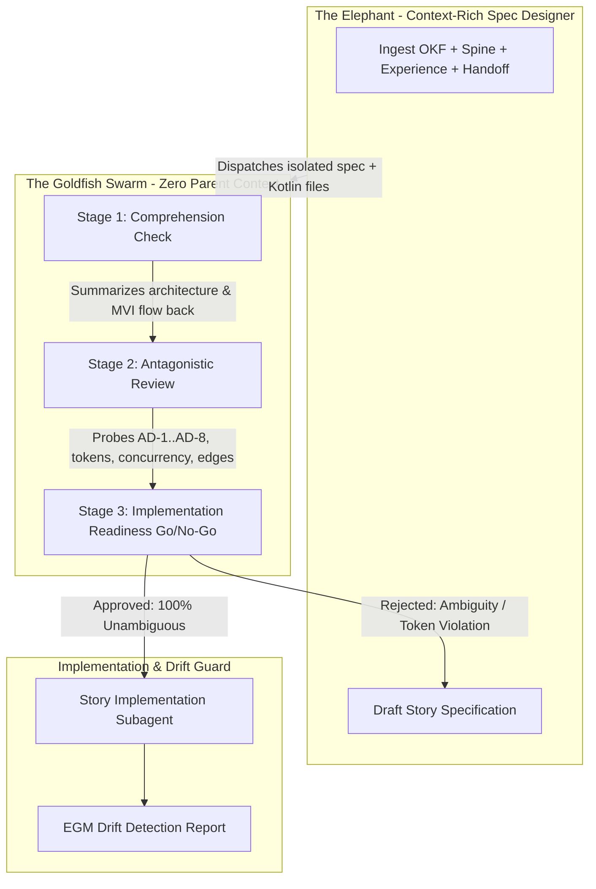

# Elephant-Goldfish Model (EGM) Design & Drift Catalog

This directory (`docs/designs/`) serves as the canonical repository for **Elephant-Goldfish Model (EGM)** artifacts within **Personal-Tracker**, including architectural concept briefs, design drafts, adversarial review synthesis logs, and post-implementation drift reports.

---

## 1. Architectural Philosophy: The Elephant & The Goldfish Swarm

Modern LLM-assisted software engineering suffers from two opposing failure modes:
1. **Context-Starved Hallucination:** Agents designing features without repository context violate architectural invariants (`AD-1` to `AD-8`), reinvents existing utility functions, and ignores hard-won debugging heuristics (`EXP-001` to `EXP-038`).
2. **Context-Polluted Sycophancy (Elephant Blindness):** Agents accumulating tens of thousands of tokens of chat history develop cognitive bias, gloss over ambiguities in their own specifications, and rubber-stamp flawed designs.

EGM solves this by bifurcating responsibilities into distinct personas and memory lifetimes:

| Role | Memory Model | Responsibilities & Invariants | Tools & Workflows |
| :--- | :--- | :--- | :--- |
| **Role 1: The Elephant (Context-Rich Spec Designer)** | Persistent, Full Context | Ingests `docs/okf/index.md`, `ARCHITECTURE-SPINE.md`, `.harness2/EXPERIENCE.md`, and `HANDOFF.md`. Synthesizes cross-cutting system requirements under a strict **"No Code During Design"** invariant. | `/egm:egm-brainstorm`, `/egm:egm-draft` |
| **Role 2: The Goldfish Swarm (Stateless Reviewers)** | Ephemeral, Zero Context | Fresh subagents spawned with **zero parent conversation history**. Receives ONLY the target spec file and referenced Kotlin source files. Executes the 3-stage review gate. | `/egm:egm-review`, `/egm:egm-review-loop`, specialized subagents |
| **Role 3: Drift Detection** | Verification Oracle | Compares checked-in specifications against live `app/src/main/` Kotlin implementations to verify zero contract, data model, or architectural divergence. | `/egm:egm-drift-report` |

---

## 2. The 3-Stage Goldfish Swarm Gate

Before implementation begins (and during post-implementation review loops), the Elephant dispatches the spec to the Goldfish Swarm:

1. **Stage A: Comprehension Check (`egm-comprehension`)**:
   - The stateless Goldfish reads the spec cold and summarizes the architecture, domain entities, and unidirectional MVI data flow back to the Elephant.
   - If the Goldfish misinterprets an interaction or invents missing details, the spec is ambiguous and must be refined before proceeding.
2. **Stage B: Antagonistic Review (`egm-design`, `egm-codebase-details`, `egm-inventive-catalyst`)**:
   - Skeptical reviewers interrogate the spec against project invariants:
     - `AD-1` Domain Purity: Zero `android.*` or `androidx.*` in `domain/`.
     - `AD-2` MVI Contracts: Immutable `UiState`, sealed `UiIntent`, Channel-backed `UiEffect`.
     - `AD-4` Non-Punitive Copy: Zero guilt, nag, or shaming language; zero companion penalty.
     - `AD-7` Token Conformance: Zero hardcoded hex colors, zero raw `dp`/`sp` literals, 48dp touch target floor.
     - Concurrency & Threading: Room `@Transaction` and repository operations on `Dispatchers.IO`.
3. **Stage C: Implementation Readiness Go/No-Go (`egm-implementation-readiness`)**:
   - Technical quality auditor verifies that exact target file paths, Kotlin data structures, function signatures, and unit test suites are fully defined. No design decisions are left to the implementer.

---

## 3. Directory Layout

- `docs/designs/briefs/`: Concept and feature brainstorm briefs created via `/egm:egm-brainstorm`.
- `docs/designs/drafts/`: Pre-implementation architectural specs and design documents.
- `docs/designs/reviews/`: Multi-lens Goldfish review findings, triage summaries, and approval records.
- `docs/designs/drift/`: Post-implementation drift reports comparing specs against live production Kotlin code.
